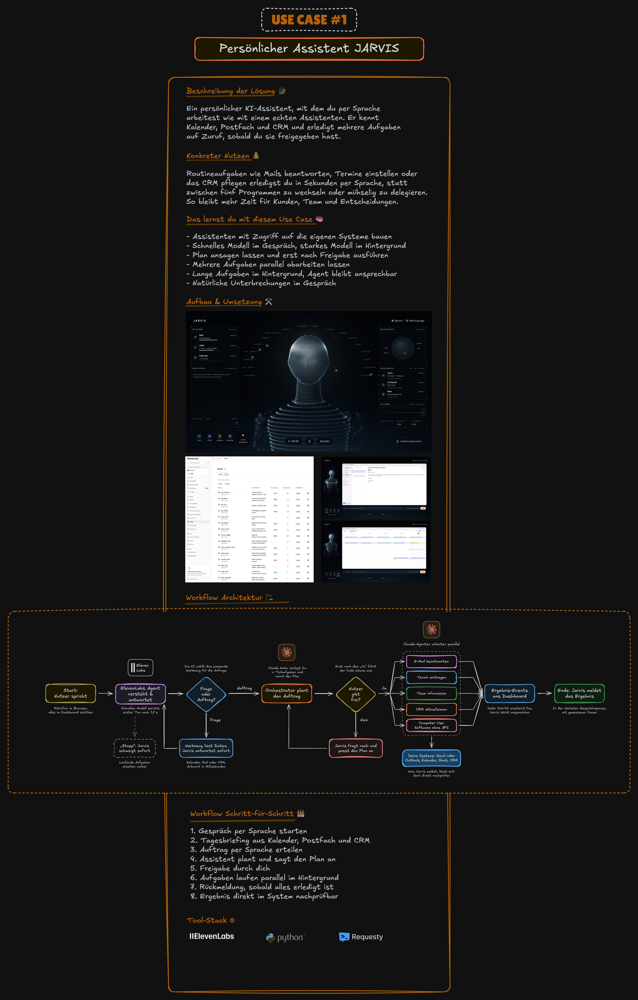

# Use Case 1: JARVIS

JARVIS ist ein deutschsprachiger Sprachassistent, der nicht nur antwortet, sondern arbeitet. Ein Satz wie „Kümmer dich um die Müller GmbH“ löst vier Aufgaben aus: Mail beantworten, Termin eintragen, Team informieren, Deal im CRM verschieben. Du siehst jeden Schritt live im Dashboard, und Jarvis bleibt währenddessen ansprechbar.

Dieser Ordner ist der einzige Use Case mit vollständigem Code. Er ist als Open-Source-Grundlage gedacht (MIT-Lizenz): klonen, mit eigenen Keys starten, erweitern. Alle Daten kommen aus einer fiktiven Testwelt (Mock-World) mit Mails, Kalender, CRM, Team-Chat und einer Praxis-Software. Eine echte Google- oder Microsoft-Anbindung ist nicht enthalten, die Prompts dafür findest du in [WEITERBAUEN.md](WEITERBAUEN.md).

**Botschaft:** Ein schnelles Modell spricht, ein starkes arbeitet im Hintergrund. Und nichts passiert, bevor du „Ja“ gesagt hast.

Im Video: Teil ⏱ folgt



Die bearbeitbare Fassung liegt in [`docs/uebersicht.excalidraw`](docs/uebersicht.excalidraw). Auf [excalidraw.com](https://excalidraw.com) öffnen: Menü, Öffnen, Datei auswählen. Wo das Bild „Deine Systeme“ zeigt, ist in diesem Repo die Testwelt angebunden.

## Kernideen

**1. Schnelles Modell vorne, schweres hinten.** Für die Stimme zählt die Zeit bis zum ersten Ton. Deshalb spricht ein schnelles Modell, und ein starkes arbeitet im Hintergrund. So geht's: erstens ein schnelles Modell für das Gespräch wählen, zweitens schwere Arbeit an ein starkes Modell abgeben, drittens bei Werkzeugen einen Überbrückungssatz wie „Einen Moment, ich schaue nach“ einstellen. Bei uns: Bis zum ersten Ton maßen wir 1,7 Sekunden mit Gemini 3.5 Flash-Lite und 3,8 Sekunden mit Gemini 3.8 Flash. Die Arbeit im Hintergrund macht Claude Haiku 5.5.

**2. Lange Aufgaben asynchron (im Hintergrund, ohne Warten).** Jarvis bleibt während der Arbeit ansprechbar und meldet sich in einer Gesprächspause mit dem Ergebnis. So geht's: erstens meldet das Werkzeug sofort eine Aufgaben-Nummer, zweitens läuft die Arbeit im Hintergrund, drittens gibt der Code das Ergebnis in einer Gesprächspause an den Agenten. Bei uns: Ein Ergebnis nur als Hintergrundwissen brachte den ElevenLabs-Agenten nicht zum Reden. Deshalb schickt der Code es als Nutzernachricht, sobald Jarvis und du kurz still seid.

**3. Plan ansagen, erst nach dem „Ja“ ausführen, im System prüfen.** Ein Satz löst mehrere Aufgaben aus, und danach prüfst du, ob alles im System steht. So geht's: erstens plant der Agent und sagt den Plan an, zweitens führt der Code erst nach dem „Ja“ aus, drittens prüfst du das Ergebnis im System. Bei uns: Jarvis plant den Auftrag, nach deiner Freigabe führt der Code vier Aufgaben gleichzeitig aus. Das Pipeline-Diagramm zeigt danach den Müller-Deal.

## Stack

| Baustein | Wofür | Ordner |
|---|---|---|
| [ElevenLabs Agents](https://elevenlabs.io/agents) | Sprach-Agent: Spracherkennung, Gesprächsmodell Gemini 3.5 Flash-Lite, Stimme. Konfiguration als Code | `agents/jarvis` |
| Next.js-Dashboard (HUD) | Mikrofon, Gespräch und Client-Tools (Werkzeuge, die im Browser laufen) | `apps/hud` |
| Orchestrator in Python | Tool-Gateway (Schnittstelle für alle Werkzeuge), Event-Hub, Freigaben, Claude Agent SDK | `services/orchestrator` |
| [Claude](https://claude.com) über [Requesty](https://www.requesty.ai) | Claude Haiku 5.5 plant Aufträge und erledigt Hintergrundaufgaben | `services/orchestrator` |
| Testwelt (Mock-World) | Fiktive Mails, Kalender, CRM, Team-Chat und Praxis-App mit Web-Oberflächen | `services/mock-world` |
| Computer-Use-Worker | Claude bedient eine Praxis-Software ohne API (Programmierschnittstelle) in einem Linux-Desktop in Docker | `services/cu-worker` |
| Contracts | Einzige Quelle für Events, Werkzeuge und Datenmodelle (TypeScript, daraus generiert JSON Schema und Python) | `packages/contracts` |

## Voraussetzungen

- **Node.js 24** und **pnpm** (`brew install node@24 pnpm` oder `corepack enable`)
- **Python 3.12** und **uv** (`brew install uv`, uv holt Python bei Bedarf selbst)
- **Docker Desktop** für den Computer-Use-Worker (nur für den vollen Lauf nötig)
- Chrome für das Dashboard. Getestet auf macOS.

Wie du Claude Code, Homebrew und die `.env`-Regel einrichtest, steht in [`00-vorbereitung`](../00-vorbereitung/).

## Konten, die du brauchst

| Dienst | Wofür | Variable in `.env` | Kosten |
|---|---|---|---|
| [ElevenLabs](https://elevenlabs.io) | Stimme und Gespräch | `ELEVENLABS_API_KEY`, `ELEVENLABS_AGENT_ID` | Free Tier vorhanden, mehr Minuten siehe [Preisseite](https://elevenlabs.io/pricing). EU-Datenresidenz nur mit EU-Workspace |
| [Requesty](https://www.requesty.ai) **oder** [Anthropic](https://console.anthropic.com) | Claude für Planung und Hintergrundaufgaben | `REQUESTY_API_KEY` oder `ANTHROPIC_API_KEY` | Abrechnung nach Verbrauch, ein Demo-Lauf kostet Cents |
| [Anthropic](https://console.anthropic.com) direkt | Computer Use im Pixel-Modus. Requesty reicht das Computer-Toolset nicht durch | `ANTHROPIC_API_KEY` | Abrechnung nach Verbrauch |

Ohne Anthropic-Key läuft Computer Use im Modus `assisted` (feste Klickfolge ohne Modell). Ohne jeden Key läuft der Mock-Modus.

## Schnellstart

```bash
git clone <URL dieses Repos>
cd mega-kurs-voice-agents-2027/01-jarvis
make install            # pnpm install, uv sync, npm ci in agents/jarvis
```

### Variante A: Mock-Modus ohne Keys

Ein simulierter Event-Stream spielt die komplette Demo ab. Kein Mikrofon, kein Key, kein Docker.

```bash
make mock                                              # Terminal 1: Event-Stream auf Port 8787
NEXT_PUBLIC_VOICE_PROVIDER=mock pnpm --filter hud dev  # Terminal 2: Dashboard auf Port 3000
```

Öffne http://localhost:3000 in Chrome. Szenarien startest du auch einzeln: `pnpm mock-events --scenario multi-agent` (weitere: `briefing-apps`, `drehbuch`, `computer-use`, `approval-call`, `leads-widget`, `full-demo`). Tasten im Dashboard: `D` Erklär-Leiste, `T` Ton, Enter und Esc für Freigaben.

### Variante B: voll lokal mit Stimme

1. `cp .env.example .env` und Keys eintragen (siehe Tabelle oben).
2. Agent in dein ElevenLabs-Konto pushen (nächster Abschnitt) und die Agent-ID als `ELEVENLABS_AGENT_ID` in die `.env` schreiben.
3. Docker Desktop starten.
4. `make demo`

`make demo` startet Testwelt, Orchestrator, Computer-Use-Container und Dashboard, setzt die Testdaten zurück, wärmt die Sprachverbindung vor und öffnet Chrome im Vollbild. Dann auf „Anrufen“ klicken und loslegen. Dazu gehören `make demo-status`, `make demo-reset` (Testdaten zurücksetzen) und `make demo-stop`. Logs liegen unter `.demo/logs/`. Der erste Build des Computer-Use-Containers dauert einige Minuten.

Ohne Stimme proben: `uv run python tools/demo_drive.py` ruft dieselben Werkzeuge über das echte Gateway auf, auch ohne ElevenLabs-Key. Ein Beispielablauf für deine eigene Vorführung steht in [`demo/BEISPIEL-ABLAUF.md`](demo/BEISPIEL-ABLAUF.md).

### Variante C: nur Tests

```bash
make test
```

Läuft ohne Keys und ohne Docker: TypeScript-Tests (Contracts, Mock-Events, Dashboard), Konfigurationstests des ElevenLabs-Agenten und die Python-Tests aller Dienste. Live-Tests mit echten APIs werden ohne Key übersprungen.

## Agent zu ElevenLabs pushen

Der Agent liegt als Code in `agents/jarvis`. `agents.json` und `tools.json` enthalten noch keine IDs, beim ersten Push legst du deinen eigenen Agenten an:

```bash
cd agents/jarvis
npm run push:plan    # Trockenlauf
npm run push:agent   # legt 18 Client-Tools und den Agenten an und liest alles zurück
```

Danach steht die Agent-ID (`agent_…`) in `agents.json`. Trag sie als `ELEVENLABS_AGENT_ID` in die `.env` ein. Startstimme ist „Daniel“, eine Standardstimme aus jedem Konto. Eine deutsche Stimme wählst du mit `npm run voices -- --render` und `npm run voices -- --select VOICE_ID`.

Standard-Host ist `https://api.elevenlabs.io`. Mit einem EU-Workspace setzt du `ELEVENLABS_API_BASE=https://api.eu.residency.elevenlabs.io` in der `.env` und `NEXT_PUBLIC_ELEVENLABS_SERVER_LOCATION=eu-residency` in `apps/hud/.env.local`. Details: [`agents/jarvis/README.md`](agents/jarvis/README.md).

Wenn du dein eigenes Repo veröffentlichst: `agents.json` und `tools.json` enthalten nach dem Push IDs aus deinem Konto.

## Projektstruktur

```text
01-jarvis/
├── agents/jarvis/          ElevenLabs-Agent als Code: Persona, Stimme, LLM, Tool-JSONs, Push- und Messskripte
├── apps/hud/               Dashboard (Next.js): Sprecher + Bühne, App-Fenster, Client-Tools, Voice-Session
│   └── design/             HTML-Vorlagen für den Bildaufbau
├── packages/contracts/     Events, Werkzeuge, Datenmodelle, Ports (Zod, generiert JSON Schema und Pydantic)
├── services/orchestrator/  Tool-Gateway (HTTP + MCP), Event-Hub, Freigaben, Planer und Claude-Agenten
├── services/mock-world/    Testwelt: REST-API, SQLite, Web-Oberflächen für Mail, CRM und Praxis-App
├── services/cu-worker/     Computer Use: Xvfb, Chromium, noVNC und Claude in Docker
├── tools/mock-events/      Simulierter Event-Stream für die Entwicklung ohne Backend
├── tools/demo.sh           Startet alles mit einem Befehl (make demo)
├── tools/demo_drive.py     Ruft die Demo-Werkzeuge ohne Stimme auf
├── demo/                   Beispielablauf für eine Vorführung
└── docs/                   Architektur, Entscheidungen, Architekturbild
```

Wie die Teile zusammenspielen und wo die Fallen liegen: [`docs/ARCHITECTURE.md`](docs/ARCHITECTURE.md). Warum etwas so gebaut ist: [`docs/DECISIONS.md`](docs/DECISIONS.md). Ports stehen in `packages/contracts/src/ports.ts`.

## Was nicht enthalten ist

- **Echte Anbindungen** an Gmail, Google Kalender, Outlook oder dein CRM. Prompts dafür: [WEITERBAUEN.md](WEITERBAUEN.md).
- **Telefonie.** Das Werkzeug `place_call` ruft einen Telefonie-Dienst unter `VOICE_AGENT_URL` auf, den es hier nicht gibt. Ohne ihn endet der Anruf mit einer Fehlermeldung.
- **Hosting.** Alles läuft lokal, ohne Login. Für einen Server brauchst du zusätzlich einen Zugangsschutz.

## Weiterbauen

Mit den Claude-Code-Prompts in [WEITERBAUEN.md](WEITERBAUEN.md) erweiterst du JARVIS um echte Kalender und Mails, dein CRM, eigene Werkzeuge, eine andere Stimme, eine Telefonnummer, neue Hintergrundaufgaben und Tests.

## Lizenz

MIT, siehe [LICENSE](LICENSE). Logos und Marken Dritter (zum Beispiel im Architekturbild) sind ausgenommen.
