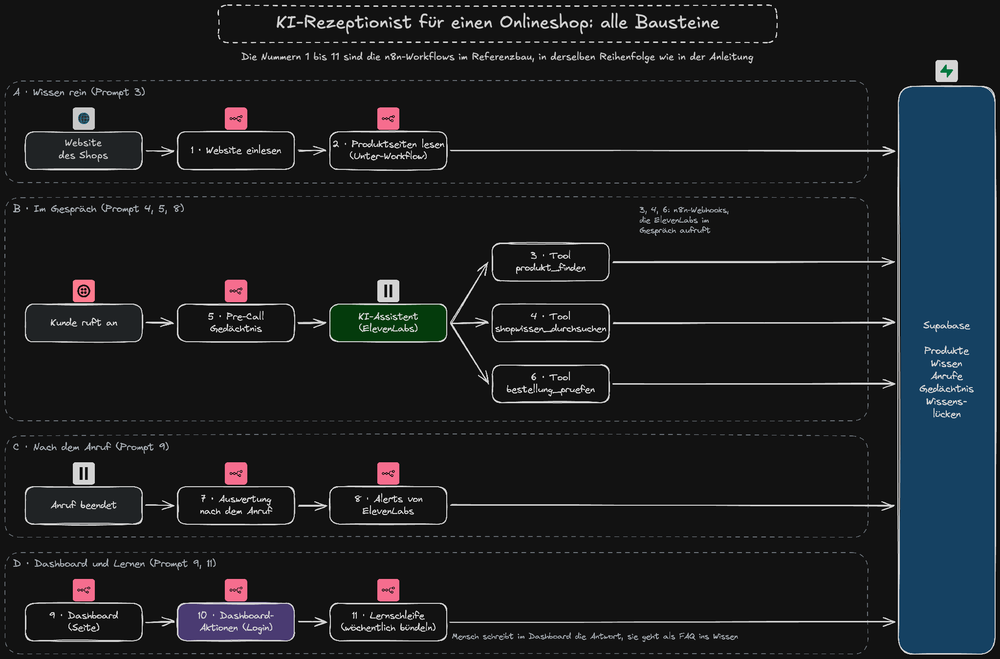

# Anleitung: Inbound KI-Rezeptionist mit ElevenLabs, n8n und Supabase

Du baust mit Claude Code einen Telefonassistenten für einen Onlineshop. Jeder Schritt ist ein Prompt, den du 1:1 an Claude schickst. Geh erst zum nächsten Prompt, wenn das Ergebnis passt.

Im Video zeigen wir das an einem Onlineshop mit Staffelpreisen. Nimm deinen eigenen Shop oder einen, bei dem du das Einlesen darfst. Überall, wo in den Prompts `<DEIN-SHOP>` steht, setzt du dessen Adresse ein, zum Beispiel `www.example.com`.

## Inhalt

- [Vorbereitung](#vorbereitung)
- [Prompt 1: Plan und Regeln](#prompt-1-plan-und-regeln)
- [Prompt 2: Website verstehen](#prompt-2-website-verstehen)
- [Prompt 3: Wissensdatenbank und Produkttabelle](#prompt-3-wissensdatenbank-und-produkttabelle)
- [Prompt 4: Drei Werkzeuge für den Agenten](#prompt-4-drei-werkzeuge-für-den-agenten)
- [Prompt 5: Agent, Version 1](#prompt-5-agent-version-1)
- [Prompt 5a: Stimme gestalten](#prompt-5a-stimme-gestalten)
- [Prompt 5b (Zusatz): Vergleich mit der ElevenLabs-Wissensbasis](#prompt-5b-zusatz-vergleich-mit-der-elevenlabs-wissensbasis)
- [Prompt 6: 10 Testszenarien](#prompt-6-10-testszenarien)
- [Prompt 7 (Zusatz): Version 2 mit Procedures](#prompt-7-zusatz-version-2-mit-procedures)
- [Prompt 8: Telefonnummer und Gedächtnis](#prompt-8-telefonnummer-und-gedächtnis)
- [Prompt 9: Auswertung, Gedächtnis und Dashboard](#prompt-9-auswertung-gedächtnis-und-dashboard)
- [Prompt 10 (Zusatz): Dokumente hochladen mit Mistral OCR](#prompt-10-zusatz-dokumente-hochladen-mit-mistral-ocr)
- [Prompt 11: Self-Learning, Wissenslücken schließen](#prompt-11-self-learning-wissenslücken-schließen)
- [Prompt 12: Flowcharts](#prompt-12-flowcharts)
- [Prompt 13: Abschluss-Check](#prompt-13-abschluss-check)
- [Prompt 14: Demo-Oberfläche zum Vorführen](#prompt-14-demo-oberfläche-zum-vorführen)
- [So zeigst du es](#so-zeigst-du-es)
- [Optional: n8n auf AWS betreiben](#optional-n8n-auf-aws-betreiben)
- [Erkenntnisse aus unseren Tests](#erkenntnisse-aus-unseren-tests)

## Vorbereitung

### Claude Code, Homebrew und Projektordner

Claude Code und Homebrew installieren und einen leeren Projektordner anlegen: Das steht für alle Use Cases gemeinsam in [`../00-vorbereitung/README.md`](../00-vorbereitung/README.md). Mach das zuerst und starte Claude Code in deinem neuen Ordner.

### Werkzeuge von Claude installieren lassen

Diese Werkzeuge braucht der Use Case: [Node.js](https://nodejs.org/de), [ElevenLabs CLI](https://elevenlabs.io/docs/eleven-agents/operate/cli) (CLI heißt Kommandozeilenwerkzeug), [Supabase CLI](https://supabase.com/docs/guides/local-development/cli/getting-started), [Twilio CLI](https://www.twilio.com/docs/twilio-cli/quickstart) und [n8n-MCP](https://github.com/czlonkowski/n8n-mcp) (MCP ist ein Standard, über den Claude andere Dienste direkt bedienen kann).

```text
Installiere mir Node.js, die ElevenLabs CLI, die Supabase CLI, die Twilio CLI und den n8n-MCP. Prüf danach mit den Versionsbefehlen, ob alles läuft, und sag mir, was fehlt. Mach danach in diesem Ordner git init.
```

Zum Nachschauen, falls etwas hakt:

```bash
brew install node supabase/tap/supabase twilio/brew/twilio
npm install -g @elevenlabs/cli
node --version && elevenlabs --version && supabase --version && twilio --version
git init
```

Danach Claude mit `/exit` beenden und neu starten, damit die frisch installierten Befehle gefunden werden.

### Konten einrichten lassen

Du brauchst eigene Konten bei den Diensten aus der Tabelle in der [README](README.md#konten-die-du-brauchst). Leg sie an, bevor du diesen Prompt schickst. Ersetz `<DEINE_N8N_URL>` durch die Adresse deiner n8n-Instanz, zum Beispiel `https://deinname.app.n8n.cloud`.

```text
Leg im Projektordner eine .env an und trag sie in die .gitignore ein. Schreib alle Variablen mit leerem Wert hinein, nur N8N_API_URL=<DEINE_N8N_URL> ist schon gesetzt.
- Ich fülle selbst aus: ELEVENLABS_API_KEY, SUPABASE_ACCESS_TOKEN, REQUESTY_API_KEY, FIRECRAWL_API_KEY, MISTRAL_API_KEY und N8N_API_KEY.
- Öffne die Datei mit open -e .env und sag mir für jeden Key, wo ich ihn im Dashboard finde. ElevenLabs auf elevenlabs.io oder, falls ich einen EU-Workspace habe, auf eu.residency.elevenlabs.io. Den Supabase-Token unter supabase.com/dashboard/account/tokens.
- Warte, bis ich gespeichert habe. Nutz die Keys danach nur über Variablen aus der .env und gib nie einen im Chat aus.
Dann richte die Konten ein:
- ElevenLabs: Frag mich, ob ich einen EU-Workspace habe. Wenn ja, stell die CLI auf die EU-Datenregion um, sonst bleib bei der Standardregion. Prüf danach, ob der Key funktioniert.
- Supabase: Leg mit dem Token ein neues Projekt in der Region Frankfurt an und trag SUPABASE_URL und SUPABASE_SERVICE_ROLE_KEY selbst in die .env nach. Nutz nur den Token, nicht supabase login.
- Twilio: Meld mich mit twilio login an.
Sag mir bei jedem Schritt, was ich im Browser bestätigen muss.
```

Welche Variablen am Ende in der `.env` stehen, siehst du in [`.env.example`](.env.example).

**EU-Workspace bei ElevenLabs:** Daten nur in der EU (EU Data Residency) gibt es bei ElevenLabs nur mit einem EU-Workspace, den du über den Enterprise-Vertrieb bekommst. Er läuft unter `eu.residency.elevenlabs.io`. Ohne ihn nutzt du ganz normal `elevenlabs.io`. Der Prompt oben funktioniert für beide Fälle, Claude fragt dich danach.

Die `.env` schützt die Keys nicht vor Claude, denn Claude hat Zugriff auf den ganzen Ordner. Sie sorgt dafür, dass die Keys nicht im Chatverlauf und nicht im Git landen. Die Supabase-Werte trägt Claude selbst ein, weil es sie beim Anlegen des Projekts ohnehin erzeugt. Nimmst du deinen Bildschirm auf, sind die Keys beim Einfügen kurz im Bild: dann nach der Aufnahme neu erzeugen.

### Claude mit Supabase, n8n und Firecrawl verbinden

```text
Richte für dieses Projekt die Verbindungen zu Supabase-MCP, n8n-MCP und Firecrawl-MCP ein. Die Supabase-Projekt-Ref steht in SUPABASE_URL in der .env, die n8n-Adresse in N8N_API_URL und der n8n-Key in N8N_API_KEY. Sag mir danach, was ich im Browser bestätigen muss oder öffne es direkt, wenn du kannst.
```

Danach Claude mit `/exit` beenden und neu starten, damit die Verbindungen geladen werden. Einmal `/mcp` eingeben und bei jeder Verbindung mit Anmeldung „Authenticate“ wählen. Supabase und Firecrawl melden sich per Browser an.

Zum Nachschauen, falls etwas hakt:

```bash
claude mcp add --transport http supabase "https://mcp.supabase.com/mcp?project_ref=<DEIN_SUPABASE_PROJEKT>"
claude mcp add n8n -e MCP_MODE=stdio -e N8N_API_URL=<DEINE_N8N_URL> -e N8N_API_KEY=$(grep '^N8N_API_KEY=' .env | cut -d= -f2-) -- npx -y n8n-mcp
claude mcp add --transport http firecrawl https://mcp.firecrawl.dev/v2/mcp-oauth
claude mcp login firecrawl
```

Dann Prompt 1 im Plan-Modus schicken (Shift+Tab). Danach Prompt für Prompt, immer erst weiter, wenn das Ergebnis passt.

## Prompt 1: Plan und Regeln

```text
Wir bauen einen KI-Telefonassistenten für den Onlineshop <DEIN-SHOP>. Er beantwortet Fragen zu Produkten, Preisen und Versand, nimmt Rückrufwünsche auf, erkennt wiederkehrende Anrufer und lernt aus Fragen, die er nicht beantworten konnte.
Stack: ElevenLabs Agent als Code mit der ElevenLabs CLI, im EU-Workspace, falls ich einen habe. Führ zuerst „elevenlabs generate-skills“ aus, damit du jeden Befehl kennst. Supabase, n8n und Firecrawl erreichst du über MCP. Embeddings laufen über Requesty mit text-embedding-3-small.
Regeln für die CLAUDE.md:
- Preise, Datum und Öffnungszeiten erfindet nie das Modell.
- Jede Prompt-Änderung nur mit Tests, eine Änderung pro Runde.
- Vor jedem Push zu ElevenLabs den Diff zeigen. Agentennamen beginnen mit „KURS-DEMO“. Keys nur in .env.
Halte Architektur und Regeln in docs/architektur.md fest und ergänze die Datei bei jedem Schritt. Mach dann einen Plan in Schritten. Nach meinem OK schreibst du nur die CLAUDE.md und docs/architektur.md, gebaut wird noch nichts.
```

> **Warum so:** Der Agent liegt als Code im Git statt als Klick-Konfiguration im Dashboard. So siehst du jede Änderung als Diff (Gegenüberstellung von alt und neu), kannst sie testen und bei Problemen zurückdrehen. Die Regeln in der CLAUDE.md gelten in jedem Schritt, du musst sie nicht in jeden Prompt schreiben.

Tipp: Gib allen Agenten, Stimmen und Workflows ein gemeinsames Präfix, zum Beispiel „KURS-DEMO“. So findest du sie im Dashboard sofort und kannst sie später sauber aufräumen.

## Prompt 2: Website verstehen

```text
Analysiere <DEIN-SHOP> mit Firecrawl, nicht mit WebFetch, denn WebFetch liefert nur eine Zusammenfassung. Welche Seitentypen gibt es, wo stehen auf einer Produktseite Preis, Staffel und Artikelnummer im HTML oder JSON-LD, welche Blöcke stören beim Einlesen, und was fragen Anrufer am häufigsten? Schreib das Ergebnis kurz in docs/website-analyse.md, darauf baut der nächste Schritt auf.
```

### Warum eine eigene Wissensdatenbank?

ElevenLabs hat eine eingebaute Wissensbasis. Du importierst die Sitemap (die Liste aller Seiten einer Website), und der Agent kennt die Website. Das ist schneller und reicht für eine Firma mit 10 bis 30 sauberen Infoseiten.

Bei einem Shop mit Staffelpreisen reicht es nicht. ElevenLabs entscheidet selbst, wie die Seiten geschnitten werden. Dann landen die Preise aus dem Block „Ähnliche Artikel“ im Wissen, und Staffelpreis-Tabellen werden zerteilt. Artikelnummern findet eine reine Bedeutungssuche schlecht. Mit Supabase und n8n bestimmst du selbst, was gespeichert wird. Preise kommen aus einer Produkttabelle und werden im Code gerechnet, die Suche findet auch exakte Nummern, und dieselbe Datenbank kannst du später für Chatbot und PDF-Upload nutzen.

**Unser Ergebnis:** Wir haben beide Wege mit denselben Fragen verglichen (siehe auch Prompt 5b).

| Frage | Eigene Wissensdatenbank | ElevenLabs-Wissensbasis |
|---|---|---|
| 120 Stück A-1042 | 1,85 Euro, zusammen 222,00 Euro, richtig | findet den Preis nicht |
| Was ist A-2210? | Wandhalter, 4,90 Euro, richtig | „gibt es nicht in unserem Sortiment“, falsch |
| Versand nach Österreich | 12,50 Euro, richtig | 12,50 Euro, richtig (steht im Prompt) |

Dazu kam: Ohne nachträglich gestarteten Index fand die ElevenLabs-Wissensbasis gar nichts und erfand Preise. Mit Index lieferte sie Preise fremder Produkte aus dem Block „Ähnliche Artikel“.

Der Preis für den eigenen Weg: Die Antwort mit Suche dauert länger, rund 2 Sekunden statt 1,5. Deshalb sagt der Agent vorher sofort „Moment, ich schaue nach“.

## Prompt 3: Wissensdatenbank und Produkttabelle

```text
Bau auf Basis deiner Analyse aus docs/website-analyse.md einen n8n-Workflow, der die Website einliest und in Supabase lädt. Entscheide selbst, welche Seiten du wie liest, und begründe es kurz. Achte besonders auf:
- Preise und Staffelpreise: Hol sie aus der zuverlässigsten Quelle der Seite und speichere sie als feste Datensätze in einer Produkttabelle, nicht als Text.
- Artikelnummern: Die Suche muss auch exakte Artikelnummern aus dem Shop finden, nicht nur ähnliche Bedeutungen.
- Störende Blöcke: Fremde Produkte, Menüs und „Ähnliche Artikel“ dürfen nicht ins Wissen.
- Last auf dem Shop: höchstens eine Anfrage pro Sekunde, große Seitenmengen in Paketen verarbeiten, immer die aktuelle Fassung lesen, keinen Cache.
- Code-Nodes: Prüf vorher, ob sie auf meiner n8n-Instanz laufen. Wenn nicht, bau die Logik in Ausdrücke und Supabase-Funktionen.
- Zugangsdaten: Leg die Keys aus der .env, die die Workflows brauchen, in n8n als Credentials an.
Teste mit 10 echten Kundenfragen, ob die richtige Seite unter den ersten drei Treffern ist.
```

> **Warum so:** Preise und Maße sind feste Fakten. Aus Textstücken liest ein Sprachmodell sie manchmal falsch ab, aus einer Tabelle nie. Hybrid Search (Vektorsuche nach Bedeutung plus Volltextsuche nach exakten Wörtern) bleibt für alles, was als Text vorliegt: Die Vektorsuche versteht „Halter für dicke Acrylplatten“, der Volltext findet „A-1042“. Im Probelauf fand nur die Hybrid-Suche die Artikelnummer.

**Unser Ergebnis:** Zwei n8n-Workflows. Der erste lädt die Sitemap, schickt die Produktseiten an den zweiten und liest Info- und Ratgeberseiten mit Firecrawl. Er teilt die Texte in Abschnitte, macht Embeddings (Zahlenvektoren, die die Bedeutung eines Textes abbilden) über Requesty und speichert alles in Supabase. Er läuft per Hand oder jeden Montag um 3 Uhr. Der zweite liest je 25 Produktseiten, eine pro Sekunde, und holt Artikelnummer, Maße und Staffelpreise aus den strukturierten Daten der Seite (JSON-LD).

**Anmerkung:** Wir lesen bewusst nicht jede einzelne Produktseite. Der Shop im Video führt Varianten wie andere Längen, V4A oder 100er-Packs nicht in der Sitemap, sie hängen nur als Auswahl an der Hauptseite. Wenn du alle Varianten brauchst, lass Claude zusätzlich die Variantenleiste und die Auswahlfelder jeder Produktseite auslesen. Das sind einige hundert Anfragen mehr, belastet den Shop und dauert deutlich länger. Für die Demo reichen die Hauptprodukte. Fragt ein Anrufer nach einer fehlenden Variante, sagt der Agent, dass er sie nicht findet, und nimmt einen Rückruf auf.

## Prompt 4: Drei Werkzeuge für den Agenten

```text
Bau drei Werkzeuge für den Agenten als n8n-Webhooks. Beachte:
- produkt_finden sucht per SQL in der Produkttabelle und rechnet den Staffelpreis für die genannte Menge im Code aus.
- shopwissen_durchsuchen nutzt die Hybrid Search für alles andere.
- bestellung_pruefen nennt den Bestellstatus. Leg dafür in Supabase eine Tabelle mit 5 fiktiven Bestellungen an. Das Werkzeug antwortet nur, wenn Bestellnummer und Postleitzahl zusammenpassen, denn Rufnummern lassen sich fälschen.
- Kein LLM in den Workflows, Antwort fertig zum Vorlesen, Ziel unter 700 Millisekunden.
- Abgesichert mit einem Key, der in ElevenLabs als Secret liegt.
```

> **Warum so:** Rechnen ist Aufgabe des Codes, nicht des Sprachmodells. So stimmt der Staffelpreis für jede Menge auf den Cent. Ein Reranker (ein zweites Modell, das die Suchtreffer neu sortiert) würde die Treffer etwas besser sortieren, kostet aber rund 600 Millisekunden. Bei 344 Produkten reichen Hybrid Search und SQL-Filter. Die Prüfung mit Bestellnummer und Postleitzahl schützt vor Anrufern, die eine fremde Nummer vortäuschen.

**Unser Ergebnis:** Drei Webhook-Workflows (ein Webhook ist eine Adresse, die ElevenLabs im Gespräch aufruft). `produkt_finden` antwortet in rund 0,2 Sekunden. `shopwissen_durchsuchen` liefert die Antwort fertig zum Vorlesen. `bestellung_pruefen` läuft mit fiktiven Bestellungen.

## Prompt 5: Agent, Version 1

```text
Leg den Agenten per ElevenLabs CLI an, der Name beginnt mit „KURS-DEMO“. Beachte:
- Der Agent bekommt die drei Werkzeuge aus n8n: produkt_finden, shopwissen_durchsuchen und bestellung_pruefen.
- Begrüßung unter 25 Wörtern mit KI-Hinweis, nicht unterbrechbar.
- Versand, Zahlung und Rückgabe direkt in den Prompt, Preise nur aus produkt_finden.
- Vor jeder Suche ein kurzer Überbrückungssatz. Datum und Telefonzeiten als Variablen mit Platzhaltern.
- LLM gemini-3.5-flash mit Reasoning minimal und Temperatur 0.1. Prüf vorher per /v1/convai/llm/list, dass es nicht als deprecated markiert ist. Deutsche Hörersignale wie „mhm“ unterbrechen nicht.
- end_call in die built_in_tools, Platzhalter für alle Variablen.
Zeig mir vor dem Push den Diff. Weil push --dry-run keinen Inhalt zeigt, schreib dafür ein kleines Skript, das die lokale Datei mit elevenlabs agents get vergleicht.
```

> **Warum so:** Häufige Fakten im Prompt sparen bei den meisten Anrufen die Suche. Datum und Telefonzeiten kommen als Variable, weil Sprachmodelle Wochentage und Feiertage falsch ausrechnen. In unseren Tests lief eine kurze Begrüßung mit KI-Hinweis in 14 von 16 Gesprächen sauber weiter, eine doppelt so lange nur in 8 von 16. gemini-3.6-flash steht in ElevenLabs auf deprecated und läuft bald aus. gemini-3.5-flash ist nicht betroffen, schnell und kann Reasoning minimal.

## Prompt 5a: Stimme gestalten

```text
Gestalte für den Agenten eine eigene Stimme mit ElevenLabs Voice Design (Modell eleven_ttv_v3). Die Beschreibung ist auf Englisch und folgt diesem Aufbau: zuerst Sprache und Region, dann Geschlecht, Alter und Qualität, dann Persona und Emotion, zum Schluss ein bis zwei Sätze zu Klangfarbe und Sprechweise. Keine Effektwörter wie Telefon, Hall oder Radio.
Als Vorschautext nimm einen echten Gesprächsausschnitt von etwa 30 Sekunden mit Begrüßung, Überbrückungssatz und einem Preis.
Erzeug drei Vorschläge und speichere sie als mp3 im Projektordner. Ich höre sie mir an und sage dir, welcher es wird. Dann speicherst du diese Stimme mit einem Namen, der mit „KURS-DEMO“ beginnt, und stellst den Agenten auf TTS-Modell eleven_v4_turbo, Sprechtempo 1.0. Zeig mir vor dem Push den Diff.
```

Diese Stimmbeschreibung hat bei uns gute Vorschläge geliefert. Du kannst sie auch direkt im ElevenLabs-Dashboard unter Voices, Voice Design einfügen:

```text
Native German, Standard High German without regional dialect. Female, late 30s. Good quality. Persona: friendly customer service rep at a small family-run online shop. Emotion: warm, attentive, relaxed. Medium pitch with a slightly warm, natural timbre. Conversational and unhurried, like a real phone call with a customer, small natural pauses, not a narrator, radio or advertising voice.
```

> **Warum so:** Unsere erste Stimme aus der Voice Library klang auf eleven_v3_conversational zu sehr nach KI. Sie ist dort als Erzählstimme für Geschichten markiert. ElevenLabs empfiehlt im Voice Design, Sprache und Region an den Anfang zu stellen, weil die Stimme sonst mit Akzent spricht. Effektwörter wie „phone“ bauen echtes Rauschen ein. Ein längerer, passender Vorschautext ergibt eine stabilere Stimme. Für Agenten empfiehlt ElevenLabs eleven_v4_turbo, weil es ausdrucksstärker klingt als v3 Conversational und mit rund 100 Millisekunden schneller startet. Jede neue Stimme und jedes neue Modell braucht danach einen echten Testanruf, weil die Textszenarien den Klang nicht prüfen.

**Unser Ergebnis:** Im fertigen Agenten läuft der erste Vorschlag aus genau dieser Stimmbeschreibung, auf eleven_v4_turbo.

## Prompt 5b (Zusatz): Vergleich mit der ElevenLabs-Wissensbasis

```text
Leg eine Kopie des Agenten an, die statt unserer Suche die eingebaute ElevenLabs-Wissensbasis nutzt, gefüllt per Sitemap-Import von <DEIN-SHOP>. Starte danach den RAG-Index für alle Dokumente und prüf mit einer RAG-Abfrage, dass Treffer kommen. Stell beiden Agenten dieselben drei Fragen: einen Staffelpreis, eine Artikelnummer und eine Versandfrage. Zeig mir die Antworten nebeneinander mit Antwortzeit und markier, wo eine Antwort falsch ist. Lösch die Kopie danach wieder.
```

**Unser Ergebnis:** Siehe die Tabelle unter [Warum eine eigene Wissensdatenbank?](#warum-eine-eigene-wissensdatenbank). Die eigene Datenbank lag bei Staffelpreis und Artikelnummer richtig, die eingebaute Wissensbasis nicht.

## Prompt 6: 10 Testszenarien

```text
Bau 10 Testszenarien als ElevenLabs-Simulationen, jedes mit Persönlichkeit, Anliegen und klarem Abnahmekriterium. Deck ab: Preisfrage mit Menge, Versandfrage, nur eine Artikelnummer, verärgerter Kunde mit Lieferverzug, ein Produkt, das es nicht gibt, Rückruf mit schnell diktierter Nummer, Großhandelsanfrage, „Bist du ein Mensch?“, ein Versuch, den Agenten aus der Rolle zu bringen, und ein Anruf außerhalb der Telefonzeiten.
Spiel jedes dreimal durch und zeig mir eine Tabelle mit bestanden ja oder nein und Begründung. Bei Fehlern schlag genau eine Prompt-Änderung vor.
```

> **Warum so:** Ein Sprachmodell antwortet nicht jedes Mal gleich. Bei uns lief dieselbe Konfiguration mittags 120 von 120 Mal richtig und abends 101 von 120 Mal. Deshalb mehrere Läufe und eine Quote statt eines Einzeltests, und pro Runde nur eine Änderung, damit du weißt, was gewirkt hat.

Laufen die Simulationstests bei dir nicht (bei uns gab es im EU-Workspace einmal ein Zeitlimit direkt nach der Begrüßung), lass Claude die Szenarien als echte Textgespräche fahren und mit einem zweiten Modell bewerten. In jedes Abnahmekriterium gehört der genaue Sollwert, zum Beispiel die vollständige Ziffernfolge der Rückrufnummer.

Später machst du aus jedem echten Fehlgespräch im ElevenLabs-Dashboard mit „Create test from this conversation“ einen weiteren Test. Die Tests laufen als Text. Stimme, Pausen und Hörersignale prüft nur ein echter Anruf. Ruf den Agenten deshalb danach im ElevenLabs-Dashboard über „Test AI agent“ im Browser an.

## Prompt 7 (Zusatz): Version 2 mit Procedures

Hier nutzt du eine neue Funktion von ElevenLabs. Procedures sind Anleitungen für einzelne Themen, die der Agent nur lädt, wenn das Thema im Gespräch aufkommt. So bleibt der Haupt-Prompt klein, und jedes Thema hat trotzdem genaue Regeln. Version 1 bleibt als Vergleich bestehen.

```text
Bau eine zweite Version in einem eigenen Branch mit ElevenLabs Procedures für drei Themen: Produktberatung, Bestellung und Reklamation, Händler und Großkunden. Jede Procedure hat einen klaren Auslöser und wird nur geladen, wenn das Thema aufkommt.
Lass die 10 Tests gegen beide Versionen laufen und starte danach ein Experiment mit 5 Prozent für Version 2. Gemergt wird erst, wenn die Tests bestehen.
```

> **Warum so:** ElevenLabs betreibt seinen eigenen Kundensupport mit rund 22.000 Anfragen im Monat mit Procedures statt mit vielen Agenten. Jede Übergabe zwischen Agenten ist eine neue Fehlerquelle, getrennte Spezialisten lohnen sich erst ab drei klar getrennten Fachgebieten. Ein Merge geht sofort live, auch ohne bestandene Tests. Deshalb steht die Regel im Prompt.

**Unser Ergebnis:** Version 2 lief als eigener Branch im selben Agenten mit 5 Prozent der Anrufe. Gemergt haben wir sie nicht, weil sie in den Tests schlechter war: 24 von 30 gegen 28 von 30 bei Version 1.

## Prompt 8: Telefonnummer und Gedächtnis

```text
Kauf mit der Twilio CLI eine deutsche Telefonnummer, verbinde sie mit dem Agenten und bau das Gedächtnis. Beachte:
- Deutsche Nummern brauchen ein Regulatory Bundle. Zeig mir Nummer und Preis, bevor du kaufst.
- Ein Pre-Call-Webhook in n8n prüft beim Klingeln, ob die Nummer schon angerufen hat, und gibt dem Agenten eine Notiz zum letzten Anruf mit.
- Die Rufnummer reicht nur für die Begrüßung. Bestelldaten gibt es weiterhin nur über bestellung_pruefen mit Bestellnummer und Postleitzahl.
Danach rufe ich zweimal an. Beim zweiten Mal muss der Agent mich erkennen. Ohne Nummer testen wir im Browser: Ein kleiner Server ruft vorher denselben Pre-Call-Webhook mit einer Test-Rufnummer auf.
```

> **Warum so:** Der Pre-Call-Webhook (ein Aufruf an deinen Workflow, bevor das Gespräch beginnt) läuft, während es noch klingelt. Er kostet keine Gesprächszeit. Ein Tool „Kundenhistorie laden“ würde den ersten Satz verzögern, und das Modell vergisst manchmal, es aufzurufen.

**Unser Ergebnis:** Ein n8n-Workflow, der beim Klingeln Datum, Telefonzeiten und die Notiz zum letzten Anruf dieser Nummer liefert. Daraus entsteht die Begrüßung mit Namen.

## Prompt 9: Auswertung, Gedächtnis und Dashboard

```text
Nach jedem Anruf soll alles in Supabase landen. Beachte:
- Per Data Collection: Anliegen, Rückrufwunsch, Name, Nummer und Fragen, die der Agent nicht beantworten konnte.
- n8n prüft die Signatur des Webhooks und schreibt die Notiz fürs Gedächtnis.
- Post-Call- und Alert-Webhook nur für diesen Agenten eintragen, nicht workspace-weit.
- Alerts von ElevenLabs per Webhook, wenn die Werkzeuge Fehler melden. Sie erscheinen im Dashboard oben als Warnung.
Bau dazu ein einfaches Dashboard, das nur lesen darf.
```

> **Warum so:** Data Collection (ElevenLabs füllt nach dem Gespräch feste Felder aus) macht aus jedem Gespräch feste Felder statt Fließtext. Die Erfolgsquote von ElevenLabs allein reicht als Messgröße nicht. Bei einem Kunden meldete sie 83 Prozent, nachgezählt waren es rund 54. Alerts melden einen Ausfall, bevor Kunden sich beschweren.

**Unser Ergebnis:** Vier Workflows. Einer empfängt den Bericht von ElevenLabs nach jedem Anruf, prüft die Signatur und speichert Anruf, Gedächtnis-Notiz und unbeantwortete Fragen. Einer empfängt Fehlermeldungen von ElevenLabs, zum Beispiel wenn ein Werkzeug ausfällt, und zeigt sie oben im Dashboard an. Einer liefert die Dashboard-Seite aus: Anrufe, bekannte Anrufer, Version 1 gegen 2, Wissenslücken. Alles, was im Dashboard etwas ändert, läuft über einen eigenen Workflow, der vorher den Login prüft.

## Prompt 10 (Zusatz): Dokumente hochladen mit Mistral OCR

```text
Bau ins Dashboard einen Bereich „Wissen hochladen“ für PDFs. Mistral OCR macht daraus Text, Tabellen bleiben erhalten, und n8n speichert ihn in derselben Wissensdatenbank wie die Website. Hochladen dürfen nur angemeldete Nutzer.
Teste mit einem PDF, das eine Tabelle enthält.
```

> **Warum so:** Normale PDF-Textauslesung zerlegt Tabellen in Wortsalat, und Scans liefern gar keinen Text. Mistral OCR (OCR heißt Texterkennung) erkennt Tabellen und gescannte Seiten und gibt Markdown zurück, das sich sauber in Abschnitte teilen lässt.

**Unser Ergebnis:** Diesen Schritt haben wir nicht gebaut. Die Tabelle für Uploads ist vorbereitet.

## Prompt 11: Self-Learning, Wissenslücken schließen

```text
Bau die Lernschleife: Einmal pro Woche werden ähnliche unbeantwortete Fragen gebündelt und im Dashboard nach Häufigkeit angezeigt. Ich schreibe die Antwort, sie geht als FAQ ins Wissen, und aus dem Gespräch wird ein neuer Test. Nichts geht ohne meine Freigabe ins Wissen. Freigeben darf nur, wer angemeldet ist, leg mir dafür einen Login mit Supabase Auth an. Bau ins Dashboard außerdem einen Knopf, der das Bündeln sofort startet, damit ich nicht bis Montag warten muss.
Teste die Schleife einmal komplett.
```

> **Warum so:** So lernt der Agent aus echten Anrufen, ohne dass sich sein Verhalten unkontrolliert ändert. ElevenLabs macht es bei seinem eigenen Rezeptionisten genauso und lässt einen Menschen freigeben, damit der Agent sich nicht auf einzelne Fälle einschießt.

**Unser Ergebnis:** Ein Workflow fasst jeden Montag ähnliche unbeantwortete Fragen zusammen und sortiert sie nach Häufigkeit. Nach der Freigabe im Dashboard wird daraus ein FAQ-Eintrag und ein neuer Test.

## Prompt 12: Flowcharts

```text
Zeichne den Ablauf eines Anrufs und wie das Wissen in die Datenbank kommt als einfaches Flowchart im Excalidraw-Stil: dunkler Hintergrund, Handschrift, Kästen von links nach rechts, über jedem Kasten das Icon des Dienstes, darunter ein kurzer Satz in Alltagssprache. Für Zuschauer ohne Technikwissen. Speichere es zusätzlich als .excalidraw-Datei, damit ich es nachbearbeiten kann.
```

**Unser Ergebnis:** [`assets/uebersicht.excalidraw`](assets/uebersicht.excalidraw), als Bild in [`assets/uebersicht.jpg`](assets/uebersicht.jpg). Zum Bearbeiten auf [excalidraw.com](https://excalidraw.com) öffnen: Menü, Öffnen, Datei auswählen.

## Prompt 13: Abschluss-Check

```text
Prüf das ganze Projekt gegen die Regeln aus der CLAUDE.md, auf Latenz und auf Sicherheit. Nenn mir die drei wichtigsten Verbesserungen und setz sie erst nach meinem OK um.
```

## Prompt 14: Demo-Oberfläche zum Vorführen

```text
Bau eine kleine Demo-Seite zum Vorführen: eine schlichte Shop-Seite mit „Jetzt anrufen“, daneben das Live-Transkript und eine Anzeige, wenn der Agent ein Werkzeug nutzt. Der Key bleibt auf einem kleinen Server, die Seite kennt ihn nicht. Vor jedem Anruf ruft der Server den Pre-Call-Webhook mit einer festen Test-Rufnummer auf, damit der Agent mich beim zweiten Anruf erkennt.
Starte alles mit einem Befehl und gib mir die Adresse.
```

## So zeigst du es

Ruf über die Demo-Seite an und frag, was 120 Stück eines Halters kosten. Der Agent rechnet den Staffelpreis live aus. Dann stell eine Frage, die der Agent nicht kennt, und zeig sie als Wissenslücke im Dashboard. Trag die Antwort ein und frag noch einmal. Zum Schluss rufst du ein zweites Mal an, und der Agent begrüßt dich mit Namen.

## So sieht das fertige Ergebnis aus



Die Nummern im Bild sind die n8n-Workflows in der Tabelle unten. Die Bereiche A bis D zeigen, was wann passiert: A füllt das Wissen, B läuft während des Gesprächs, C nach dem Anruf, D im Dashboard.

| Nr. | Workflow | Was er macht | Prompt |
|---|---|---|---|
| 1 | Website einlesen | Lädt die Sitemap, schickt die Produktseiten an Workflow 2 und liest Info- und Ratgeberseiten mit Firecrawl. Teilt die Texte in Abschnitte, macht Embeddings über Requesty und speichert alles in Supabase. Läuft per Hand oder jeden Montag um 3 Uhr. | 3 |
| 2 | Produktseiten lesen (Unter-Workflow) | Liest je 25 Produktseiten, eine pro Sekunde, und holt Artikelnummer, Maße und Staffelpreise aus den strukturierten Daten der Seite. Läuft nur, wenn Workflow 1 ihn aufruft. | 3 |
| 3 | Tool produkt_finden | Werkzeug des Agenten für Preise und Maße. Sucht per SQL in der Produkttabelle und rechnet den Staffelpreis aus. Antwort in rund 0,2 Sekunden. | 4 |
| 4 | Tool shopwissen_durchsuchen | Werkzeug des Agenten für Montage, Versand und Ratgeber. Hybrid Search über die Textabschnitte, Antwort fertig zum Vorlesen. | 4 |
| 5 | Pre-Call Gedächtnis | Läuft beim Klingeln. Liefert Datum, Telefonzeiten und die Notiz zum letzten Anruf dieser Nummer. Daraus entsteht die Begrüßung mit Namen. | 8 |
| 6 | Tool bestellung_pruefen | Werkzeug des Agenten für den Bestellstatus. Antwortet nur, wenn Bestellnummer und Postleitzahl zusammenpassen. Bei uns mit fiktiven Bestellungen. | 4 |
| 7 | Auswertung nach dem Anruf | Empfängt den Bericht von ElevenLabs nach jedem Anruf, prüft die Signatur und speichert Anruf, Gedächtnis-Notiz und unbeantwortete Fragen. | 9 |
| 8 | Alerts von ElevenLabs | Empfängt Fehlermeldungen von ElevenLabs, zum Beispiel wenn ein Werkzeug ausfällt, und zeigt sie oben im Dashboard an. | 9 |
| 9 | Dashboard (Seite) | Liefert die Dashboard-Seite aus: Anrufe, bekannte Anrufer, Version 1 gegen 2, Wissenslücken. Nur lesen. | 9 |
| 10 | Dashboard-Aktionen (nur angemeldet) | Alles, was im Dashboard etwas ändert, läuft hier durch, zum Beispiel eine Antwort auf eine Wissenslücke freigeben. Prüft vorher den Login. | 9, 11 |
| 11 | Lernschleife (wöchentlich bündeln) | Fasst jeden Montag ähnliche unbeantwortete Fragen zusammen und sortiert sie nach Häufigkeit. Nach der Freigabe im Dashboard wird daraus ein FAQ-Eintrag und ein neuer Test. | 11 |

Dazu kommen der ElevenLabs-Agent (Version 1 mit 95 Prozent der Anrufe, Version 2 mit Procedures als Branch mit 5 Prozent) und ein Supabase-Projekt mit Produkten, Wissen, Anrufen, Gedächtnis und Wissenslücken.

## Optional: n8n auf AWS betreiben

Die Workflows laufen weiter in n8n. Hier zieht n8n nur auf einen eigenen Server bei AWS in Frankfurt um, damit alle Daten in der EU und im eigenen Konto liegen. Dafür ist die AWS CLI nötig (`brew install awscli`, dann `aws configure`).

```text
Ich will n8n in meinem eigenen AWS-Konto in Frankfurt betreiben statt auf fremder Infrastruktur. Zeig mir die einfachste Lösung mit den monatlichen Kosten. Führe mich dann Schritt für Schritt durch die Einrichtung und zieh meine Workflows um. Leg nichts in AWS an, bevor ich zustimme.
```

## Erkenntnisse aus unseren Tests

Diese Punkte stammen aus einem zweiten Testbau: einer Praxis-Rezeption (Physiopraxis mit Terminvergabe), gebaut mit ElevenLabs CLI, Prompt-Dateien im Repo und einem kleinen Server, der Öffnungsstatus, Feiertage und freie Termine rechnet. Die Beispiele kommen aus diesem Bau, die Regeln gelten genauso für den Shop-Rezeptionisten.

Die Kernbotschaft: **Die KI redet, der Code entscheidet.**

- **CLI, MCP, API und Oberfläche:** In der Oberfläche änderst du den Agenten per Klick. Über MCP kann Claude die Plattform bedienen, mit der CLI lädst du Konfigurationsdateien hoch, die im Repo liegen, und über die API greifen Programme bei jedem Anruf auf den Dienst zu. Wir bauen über die CLI, weil der Agent dann eine Datei ist, die man vergleichen, testen und zurückdrehen kann. Die Oberfläche nutzen wir für Hörproben.
- **Die CLI ist neu und hat Fallen:** Leg eine feste Version fest. Bei uns lud die CLI immer alle Agenten hoch, auch ohne Änderung, und ihr Probelauf zeigte keinen Inhalt. Deshalb gibt es in Prompt 5 ein eigenes Vergleichsskript, das du vor jedem Hochladen ansiehst.
- **Stimme prompten:** Wie der Agent klingt, steuern kurze Sätze und feste Regeln für Zahlen im Prompt. Bei uns stand dort „Höchstens zwei kurze Sätze pro Antwort.“ und „Telefonnummern Ziffer für Ziffer in Zweiergruppen“. Datum und Uhrzeit liefert der Code fertig in Worten. Audio-Tags (Regieanweisungen für die Stimme) haben wir abgeschaltet.
- **Raus aus dem Prompt:** Berechenbare Fakten gehören in den Code, weil ein Sprachmodell Wochentage und Feiertage nicht zuverlässig rechnet. Markiere im Prompt jede Rechenaufgabe, schreib dafür eine Funktion mit Tests und gib das Ergebnis als fertigen Satz in den Prompt. Bei uns sagte Version 1 mit Öffnungszeiten im Prompt am Karfreitag 5 von 5 Mal „geöffnet“. Version 2 bekam den Status vom Code und sagte 3 von 3 Mal richtig „geschlossen“.
- **Dynamische Prompts:** Der Prompt hat Platzhalter, die der Code vor jedem Gespräch für genau diesen Anruf füllt. Prüf per Test, dass Prompt und Code dieselben Variablennamen nutzen. Bei uns stand im Prompt „Praxis-Status: {{oeffnungsstatus_satz}}“, am Karfreitag wurde daraus „Heute ist Karfreitag, die Praxis ist geschlossen. Wir sind am Dienstag, den siebten April, ab sieben Uhr dreißig wieder da.“
- **Pre-Call-Webhooks:** ElevenLabs fragt vor dem „Hallo“ deinen Server nach den Werten für dieses Gespräch. Der Endpunkt bekommt die Anrufernummer, berechnet daraus Status, Feiertag und Anrufer und gibt die Werte im Format von ElevenLabs zurück. Den Webhook gibt es nur bei Telefonie. Im Browser holt die Seite dieselben Werte aus derselben Funktion, genau wie die Demo-Seite in Prompt 14.
- **Variablen je Uhrzeit und Feiertag:** Öffnungszeiten liegen als Daten vor, Feiertage je Bundesland, Mittagspause und nächste Öffnung rechnet der Code. Teste die Grenzfälle. Bei uns nannte der Agent nach Karfreitag richtig Dienstag, weil Ostermontag dazwischen liegt.
- **Kundendaten holen:** Der Code erkennt den Anrufer vor dem Gespräch an der Nummer und gibt Name und nächsten Termin als Variable mit. Der Agent fragt zuerst „Spreche ich mit …?“ und nennt Daten erst nach Bestätigung.
- **Tool-Calls vor oder nach dem Gespräch:** Jeder Werkzeugaufruf im Gespräch kostet Wartezeit. Lade vorher, was vor dem Anruf feststeht, prüf im Gespräch nur, was sich laufend ändert, und erzeug Ticket und Mail nach dem Auflegen. Bei uns liefen im Gespräch nur zwei Werkzeuge, Terminsuche und Vormerken. Fehlende Felder blieben im Ticket „offen“.
- **RAG mit Mistral OCR:** RAG heißt, der Agent schlägt in einer Wissensbasis nach. Wandle PDFs mit Mistral OCR in Markdown um, räum den Text auf, bau Tabellen in Sätze um und teste mit echten Anruferfragen. Öffnungszeiten gehören nie in die Wissensbasis.
- **Prompt-Testing:** Schreib feste Testfälle mit Ausgangslage und Bestehensbedingung und sperr ein Prüfset, an dem du beim Bauen nicht drehst. Beispiel: Der Anrufer sagt „Ich brauche Krankengymnastik, Rezept habe ich. Haben Sie morgen früh um neun noch was frei?“ Bestanden ist der Fall, wenn der Agent keine Uhrzeit zusagt, ohne vorher nachzusehen.
- **A/B-Tests:** Lass beide Versionen offline gegen dieselben Testfälle laufen, leg vorher eine Hauptmetrik fest und starte live erst mit genug Anrufen und einem kleinen Anteil. Eine Praxis hat für einen Live-A/B-Test zu wenige Anrufe, ein Shop eher genug.
- **Was uns sonst begegnet ist:** Das Modell las einmal seinen Denktext vor, deshalb steht Reasoning auf minimal. Aus „7. April“ wurde „siebenundzwanzigsten April“, deshalb liefert der Code Datum und Uhrzeit in Worten. Audio-Tags verschmutzten das Transkript, deshalb sind sie abgeschaltet. Der Agent las trotz Verbot die Rückrufnummer vor, deshalb bekommt er nur noch „bekannt: ja oder nein“. Er sprach einmal den Werkzeugnamen „end_call“ aus, deshalb steht im Ablauf kein Werkzeugname mehr.
