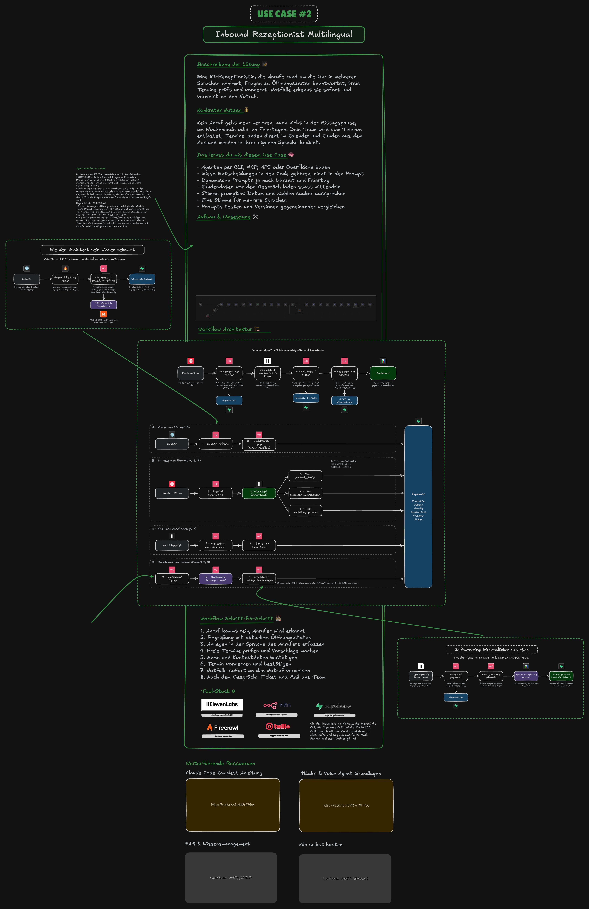

# Use Case 2: Inbound KI-Rezeptionist

Du baust mit Claude Code einen Telefonassistenten für einen Onlineshop. Er beantwortet Fragen zu Produkten, Preisen und Versand, nennt den Bestellstatus, nimmt Rückrufwünsche auf, erkennt wiederkehrende Anrufer und lernt aus Fragen, die er nicht beantworten konnte.

Im Video zeigen wir das an einem Onlineshop mit Staffelpreisen. Nimm deinen eigenen Shop oder einen, bei dem du das Einlesen darfst.

**Botschaft:** Die KI redet, der Code entscheidet. Preise, Datum und Öffnungszeiten kommen nie aus dem Sprachmodell, sondern aus einer Tabelle oder aus Code.

Im Video: Teil ⏱ folgt

**Zur Schritt-für-Schritt-Anleitung: [ANLEITUNG.md](ANLEITUNG.md)**

Für diesen Use Case gibt es keinen Referenzcode. Du baust alles selbst mit den Prompts aus der Anleitung.

## Wie das Ergebnis aussieht

- Ein Anrufer fragt: „Was kosten 120 Stück von A-1042?“ Der Agent sagt „Moment, ich schaue nach“ und nennt den Staffelpreis auf den Cent: 1,85 Euro pro Stück, zusammen 222,00 Euro.
- Kennt der Agent eine Antwort nicht, sagt er das ehrlich und bietet einen Rückruf an. Die Frage landet als Wissenslücke im Dashboard. Du schreibst die Antwort, gibst sie frei, und beim nächsten Anruf kennt der Agent sie.
- Ruft dieselbe Nummer ein zweites Mal an, begrüßt der Agent den Anrufer mit Namen.
- Ein Dashboard zeigt alle Anrufe, bekannte Anrufer, Version 1 gegen Version 2 und die Wissenslücken.

Die bearbeitbare Fassung liegt in [`assets/uebersicht.excalidraw`](assets/uebersicht.excalidraw). Auf [excalidraw.com](https://excalidraw.com) öffnen: Menü, Öffnen, Datei auswählen. Eine Übersicht mit allen 11 n8n-Workflows findest du in der Anleitung unter [So sieht das fertige Ergebnis aus](ANLEITUNG.md#so-sieht-das-fertige-ergebnis-aus).

## Stack

| Baustein | Wofür |
|---|---|
| [Claude Code](https://claude.com/product/claude-code) | Baut alles nach deinen Prompts |
| [ElevenLabs Agents](https://elevenlabs.io/agents) | Sprach-Agent mit Stimme, Testszenarien und Procedures, verwaltet als Code mit der ElevenLabs CLI |
| [n8n](https://n8n.io) | Workflows für Website-Import, Werkzeuge des Agenten, Pre-Call-Webhook, Auswertung, Dashboard und Lernschleife |
| [Supabase](https://supabase.com) | Postgres-Datenbank mit pgvector (Erweiterung für Vektorsuche): Produkttabelle, Wissen, Anrufe, Gedächtnis, Wissenslücken, Login |
| [Firecrawl](https://www.firecrawl.dev) | Liest Info- und Ratgeberseiten des Shops ohne Menüs und fremde Produkte |
| [Requesty](https://www.requesty.ai) | Embeddings (Zahlenvektoren für die Bedeutungssuche) mit text-embedding-3-small |
| [Mistral OCR](https://mistral.ai) | Macht aus PDFs sauberen Text mit Tabellen (optionaler Schritt) |
| [Twilio](https://www.twilio.com) | Echte deutsche Telefonnummer (optional, testen geht auch im Browser) |

## Konten, die du brauchst

| Dienst | Website | Kosten |
|---|---|---|
| ElevenLabs | [elevenlabs.io](https://elevenlabs.io) | Free Tier vorhanden. Für mehr Gesprächsminuten siehe [Preisseite](https://elevenlabs.io/pricing). Daten nur in der EU gibt es nur mit einem EU-Workspace (Enterprise) |
| Supabase | [supabase.com](https://supabase.com) | Free Tier vorhanden, reicht für diesen Use Case |
| n8n | [n8n.io](https://n8n.io) | n8n Cloud mit kostenloser Testphase, danach siehe [Preisseite](https://n8n.io/pricing). Selbst gehostet ist die Community Edition kostenlos, du zahlst nur den Server |
| Requesty | [requesty.ai](https://www.requesty.ai) | Abrechnung nach Verbrauch, siehe Preisseite. Embeddings für einen kleinen Shop kosten nur Cents |
| Firecrawl | [firecrawl.dev](https://www.firecrawl.dev) | Free Tier vorhanden, siehe [Preisseite](https://www.firecrawl.dev/pricing) |
| Mistral | [mistral.ai](https://mistral.ai) | Siehe Preisseite. Nur für den optionalen PDF-Upload nötig |
| Twilio (optional) | [twilio.com](https://www.twilio.com) | Testguthaben vorhanden. Eine deutsche Nummer kostet monatlich und braucht ein Regulatory Bundle (Identitätsnachweis), siehe Preisseite |

Welche Keys in die `.env` gehören und wo du sie findest, steht in [`.env.example`](.env.example).

## Inhalt dieses Ordners

| Datei | Inhalt |
|---|---|
| [ANLEITUNG.md](ANLEITUNG.md) | Vorbereitung, alle Prompts mit „Warum so“ und „Unser Ergebnis“, Erkenntnisse aus unseren Tests |
| [assets/](assets/) | Architekturbild als PNG und Excalidraw, Übersicht aller Bausteine |
| [.env.example](.env.example) | Alle Variablen mit Hinweis, wo du den jeweiligen Key findest |
