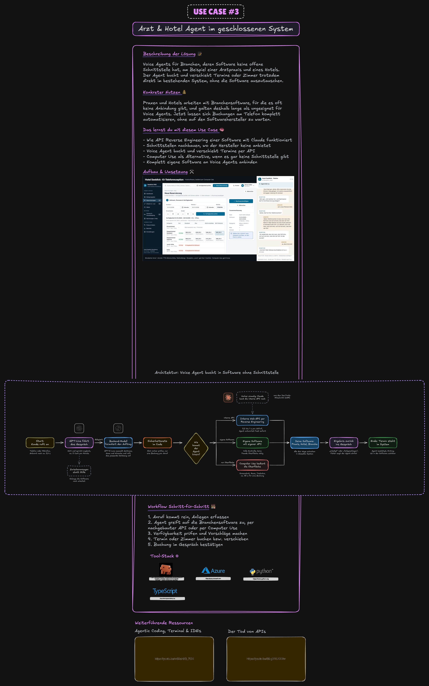

# Use Case 3: Arzt und Hotel

Du baust mit Claude Code zwei deutschsprachige Telefonagenten für Software, die keine offene Schnittstelle hat.
**Lena** nimmt Anrufe für ein Hotel an und bucht per Computer Use (das Modell bedient die Oberfläche nur über
Screenshots, Maus und Tastatur) direkt in der Hotelsoftware. **Sophie** nimmt Anrufe für eine Arztpraxis an und bucht
in einer US-Praxissoftware über deren interne Web-Schnittstelle, die Claude vorher per Reverse Engineering
(Nachbauen einer Schnittstelle aus dem mitgeschnittenen Datenverkehr) dokumentiert. Teil B ist eine technische Demo
mit einem Testkonto und erfundenen Patienten, keine Anleitung für den Einsatz in einer echten Praxis.

**Botschaft:** Software ohne Schnittstelle ist kein Hindernis mehr.

Im Video: Teil ⏱ folgt

## Wie das Ergebnis aussieht

- **Hotel:** Links die Hotelsoftware „Seeblick PMS“, rechts eine Anruf-Oberfläche mit Live-Mitschrift. Du rufst an,
  Lena fragt nach Zeitraum, Personen und Kontaktdaten, fasst zusammen und bucht nach deinem Ja. Währenddessen bewegt
  sich links die Software von selbst, am Ende nennt Lena die Reservierungsnummer.
- **Arzt:** Links der Kalender der Praxissoftware, rechts die Anruf-Oberfläche mit jedem HTTP-Aufruf samt
  Dauer. Sophie sucht die Patientin, nennt freie Zeiten aus dem System und trägt den Termin ein. Der Kalender springt
  sofort auf den neuen Termin.
- **Der Unterschied:** Lena braucht für eine Buchung rund 35 Sekunden Klicken, Sophie bekommt jede Antwort der
  Software in 0,2 bis 1 Sekunde. Reverse Engineering macht den Agenten schnell.

## Architektur

Die Excalidraw-Datei zum Bearbeiten liegt unter [`assets/uebersicht.excalidraw`](assets/uebersicht.excalidraw).

## Stack

| Baustein | Wofür |
|---|---|
| OpenAI gpt-live-1 | Stimme: hört und spricht zugleich (Vollduplex), führt das Gespräch |
| OpenAI gpt-6-luna | Backend: formuliert Aufträge, ruft Werkzeuge auf, bedient per Computer Use die Hotelsoftware |
| OpenAI Agents SDK | Computer-Use-Agent und Live-Beispiele als Vorlage |
| Python 3.12, uv | Laufzeit und Paketverwaltung |
| Playwright mit Chromium | Sichtbares Browserfenster, das der Agent bedient |
| ffmpeg | Video vom simulierten Anruf |
| [`hotel-demo/`](hotel-demo/) | Fertige Hotelsoftware als eine HTML-Datei, läuft ohne Server |
| Praxissoftware | US-Praxissoftware ohne öffentliche Schnittstelle, Testversion (nur Teil B) |

## Was am Ende entsteht

| Nr. | Teil | Was er macht | Prompt |
|---|---|---|---|
| 1 | Hotelsoftware | Belegungsplan, Reservierungen, Gäste, Check-in, Rechnungen in einer Datei. Daten liegen im Browser und lassen sich zurücksetzen | liegt fertig bei |
| 2 | Deutsch-Test | Prüft, ob gpt-live-1 Deutsch versteht und spricht, und misst die Antwortzeit | 2 |
| 3 | Computer-Use-Agent | Bedient die Hotelsoftware nur über Screenshots, Maus und Tastatur. Bekommt einen Auftrag als Satz, gibt Reservierungsnummer oder Fehler zurück | 3 |
| 4 | Lena | Telefon-Agent fürs Hotel mit Anruf-Oberfläche, gibt Buchungen an den Computer-Use-Agenten weiter | 4 |
| 5 | Simulierter Anruf | Ein zweites Modell spielt den Gast, Ergebnis ist ein Video plus automatische Prüfung | 5 |
| 6 | Doku der internen Schnittstelle | Endpunkte der Praxissoftware für Patienten und Termine, mit Anmeldung, Zeitformat und Stolperfallen | 7 |
| 7 | Client für die Praxissoftware | Meldet sich wie der Browser an, sucht Patienten, rechnet freie Termine aus, bucht und verschiebt | 8 |
| 8 | Sophie | Telefon-Anmeldung der Praxis, bucht über die nachgebaute Schnittstelle statt per Klick | 9 |

## Konten, die du brauchst

| Konto | Wofür | Ungefähre Kosten |
|---|---|---|
| [OpenAI Platform](https://platform.openai.com) mit Zugriff auf gpt-live-1 und gpt-6-luna | Stimme, Backend, Computer Use | gpt-live-1 rund 0,05 Dollar pro Minute. Ein Buchungsanruf bei Lena kostete uns 0,22 bis 0,30 Dollar, ein Computer-Use-Auftrag rund 1 Cent |
| Testversion einer Praxissoftware | Nur für Teil B (Arzt), Auswahl in Prompt 6 | viele Anbieter haben eine kostenlose Testphase |
| [Twilio](https://www.twilio.com) | Optional: echte Telefonnummer per SIP | Nummer plus Minutenpreis laut Twilio, deutsche Nummern brauchen ein Regulatory Bundle |

Die Hotelsoftware braucht kein Konto, sie liegt in diesem Ordner.

## Wichtig für Teil B

Reverse Engineering nur mit deinem eigenen Testkonto, ausschließlich mit erfundenen Patienten und nur, wenn die AGB
des Herstellers es nicht verbieten. Für den Einsatz in einer echten Praxis brauchst du die Erlaubnis des Herstellers. Details stehen in der [Anleitung](ANLEITUNG.md#teil-b-arztpraxis-sophie-bucht-über-die-nachgebaute-schnittstelle).

## Los geht's

Schritt für Schritt mit allen Prompts: **[ANLEITUNG.md](ANLEITUNG.md)**. Vorher einmal [`../00-vorbereitung/`](../00-vorbereitung/README.md) durchgehen.
