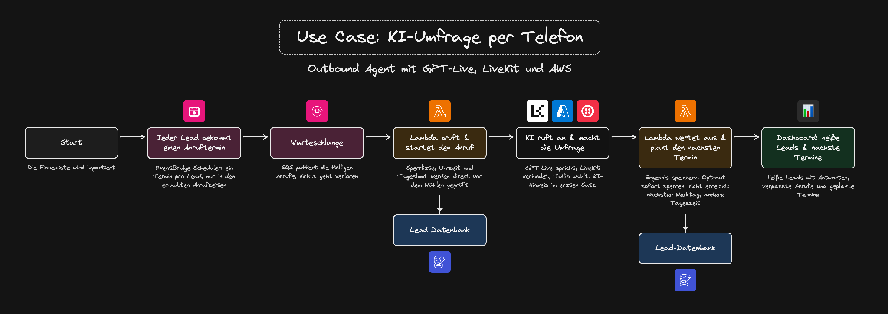
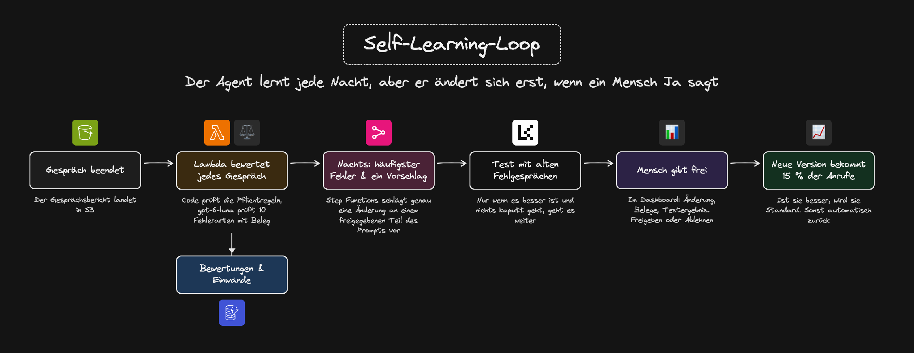

# Anleitung: Outbound Cold Calling mit GPT-Live, LiveKit und AWS

Du baust mit Claude Code einen Agenten, der Firmen anruft und eine kurze Umfrage „KI im Mittelstand“ macht.
Das Gespräch führt GPT-Live über LiveKit. Planung, Wiederholungen und Auswertung laufen komplett auf AWS.
Jede Nacht lernt der Agent aus seinen Gesprächen, aber er ändert sich erst, wenn ein Mensch Ja sagt.

## Ablauf vorab





Das komplette Use-Case-Board mit beiden Abläufen kannst du in [Excalidraw](https://excalidraw.com) öffnen und bearbeiten: [`assets/uebersicht.excalidraw`](assets/uebersicht.excalidraw).

| Baustein | Aufgabe |
|---|---|
| EventBridge Scheduler (Zeitplaner von AWS) | Jeder nächste Anruf eines Leads ist ein eigener Termin mit Uhrzeit. Du siehst in der AWS-Konsole, wann wer angerufen wird. |
| SQS FIFO mit Dead-Letter-Queue (Warteschlange mit fester Reihenfolge und Ablage für Fehlschläge) | Puffer vor dem Wählen. Eine einzige Nachrichtengruppe sorgt für die Reihenfolge, kein Auftrag geht verloren. |
| Anruf-Slot in DynamoDB (Datenbank von AWS) | Begrenzt, wie viele Gespräche gleichzeitig laufen. Der Dispatcher holt ihn, erst das Ergebnis gibt ihn frei. |
| Lambda Dispatcher (Funktion ohne eigenen Server) | Prüft direkt vor dem Wählen alle Regeln und startet den Anruf in LiveKit. |
| LiveKit Cloud (EU) und Agent-Worker | Führen das Gespräch mit GPT-Live über Azure, mit Rauschunterdrückung und Mailbox-Erkennung. Über Twilio geht es ins Telefonnetz. |
| API Gateway, Lambda Ergebnis und Lambda Sperre | Nehmen Ergebnis und Opt-out an, berechnen den nächsten Schritt und legen den nächsten Termin an. |
| EventBridge Bus (Verteiler für Ereignisse) | Verteilt Ereignisse wie „Lead heiß“ an das Dashboard und später an ein CRM. |
| S3, Lambda Judge, Step Functions (Ablaufsteuerung) | Die Lernschleife: Bericht je Anruf, Bewertung, nächtlicher Verbesserungsvorschlag mit Freigabe im Dashboard. |
| DynamoDB | Leads, Versuche, Slot, Sperrliste, Rückrufe, Bewertungen und Prompt-Versionen. |
| Secrets Manager, CloudWatch, Budget | Keys, Alarme und eine Kostengrenze. |
| S3, CloudFront und Cognito (Login-Dienst) | Das Dashboard mit Login. |

## Vorbereitung

### 0. Claude Code, Homebrew, Plan-Modus

Steht in [`../00-vorbereitung/README.md`](../00-vorbereitung/README.md). Mach das zuerst, es gilt für alle Use Cases.

### Konten, die du brauchst

| Dienst | Wofür | Darauf achten |
|---|---|---|
| AWS | Steuerung, Datenbank, Lernschleife, Dashboard | Region Frankfurt (`eu-central-1`) |
| Azure mit Azure OpenAI | GPT-Live für das Gespräch, `gpt-6-luna` für Tools und Bewertung | Region Sweden Central. GPT-Live gibt es dort nur als Global Standard |
| oder OpenAI direkt | Alternative zu Azure, gleiche Modelle | Datenschutz selbst prüfen |
| LiveKit Cloud | Verbindet Modell, Browser und Telefon | EU-Datenregion beim Anlegen wählen, die Region lässt sich später nicht ändern |
| Twilio | Deutsche Telefonnummer und SIP-Anbindung | Eine deutsche Nummer braucht ein genehmigtes Regulatory Bundle (Nachweis von Firma und Adresse). Das dauert mehrere Tage, beantrag es gleich zu Beginn |

Twilio brauchst du erst in Prompt 11. Bis dahin klingelt der Agent in einer Testseite im Browser.

### 1. Werkzeuge von Claude installieren lassen

Starte `claude` in einem beliebigen Ordner und schick:

#### Prompt V1: Werkzeuge installieren

```text
Installiere mir Node.js, uv für Python, die AWS CLI, das AWS CDK, die Azure CLI, die LiveKit CLI und die Twilio CLI. Prüf danach mit den Versionsbefehlen, ob alles läuft, und sag mir, was fehlt.
```

Zum Nachschauen, falls etwas hakt:

```bash
brew install node uv awscli azure-cli livekit-cli twilio/brew/twilio
npm install -g aws-cdk
node --version && uv --version && aws --version && cdk --version && az --version && lk --version && twilio --version
```

### 2. Projektordner anlegen

Beende Claude vorher mit `/exit`, dann:

```bash
mkdir outbound-agent && cd outbound-agent && git init && claude
```

Du startest im leeren Projektordner neu. So findet Claude auch die frisch installierten Befehle. Kopier die
[`.env.example`](.env.example) aus diesem Ordner als Vorlage in dein Projekt.

### 3. Konten einrichten lassen

#### Prompt V2: Konten einrichten

```text
Richte alle Konten für dieses Projekt mit den CLIs ein und trag die Werte in eine .env ein, die in .gitignore steht. Nimm .env.example als Vorlage. Gib nie einen Key im Chat aus.
- AWS: Meld mich mit aws configure sso an, Region eu-central-1 (Frankfurt). Führ danach cdk bootstrap aus.
- Azure: Meld mich mit az login an. Stehen schon Azure-Keys in der .env, prüf nur, ob sie funktionieren. Sonst schlag mir eine neue Azure-OpenAI-Ressource in Sweden Central vor, mit einem Deployment für GPT-Live (Global Standard) und einem zweiten für gpt-6-luna über die Responses-API, denn nur damit laufen Tools. Zeig mir Region, Namen und Kosten und leg erst nach meinem OK etwas an. Nutze ich OpenAI direkt statt Azure, frag mich nach dem OpenAI-Key und trag ihn ein.
- LiveKit: Meld mich mit lk cloud auth an und verknüpf mein Projekt. Das Projekt muss in der EU-Datenregion liegen. URL, Key und Secret schreibst du mit lk app env in die .env.
- Twilio: Meld mich mit twilio login an und sag mir, ob für eine deutsche Nummer schon ein genehmigtes Regulatory Bundle vorliegt.
Sag mir bei jedem Schritt, was ich im Browser bestätigen muss.
```

Die `.env` hält die Keys aus dem Chatverlauf und aus dem Git heraus, vor Claude schützt sie sie nicht. Nimmst du
den Bau auf, sind Keys beim Einfügen kurz im Bild: im Schnitt verpixeln oder danach erneuern.

GPT-Live gibt es auf Azure nur als Global Standard: Die Daten liegen in der EU, verarbeitet werden sie unter
Umständen weltweit. Vor echten Leads gehört das in die Datenschutzprüfung.

Gibt es noch kein LiveKit-Projekt, legst du es beim Login im Browser an und wählst dabei die EU-Datenregion.
Danach Prompt 1 im Plan-Modus schicken (Shift+Tab). Prompt für Prompt, immer erst weiter, wenn das Ergebnis passt.

## Prompt für Prompt

### Prompt 1: Plan und Regeln

```text
Wir bauen einen Outbound-Voice-Agenten, der Firmen anruft und eine 60-Sekunden-Umfrage „KI im Mittelstand“ macht.
Architektur: Das Gespräch läuft mit LiveKit Agents 1.8.8 in Python und GPT-Live über Azure, der Agent liegt in LiveKit Cloud in der EU. Die Steuerung läuft komplett auf AWS in Frankfurt, als Code mit CDK in Python: EventBridge Scheduler für die Anruftermine, SQS als Warteschlange, Lambda für die Logik, DynamoDB als Datenbank. Jede Nacht lernt der Agent aus seinen Gesprächen, aber nur mit meiner Freigabe.
Regeln für die CLAUDE.md:
- Im ersten Satz der Hinweis, dass eine KI anruft. Rufnummer nie unterdrücken.
- Nur fiktive Test-Leads, angerufen werden nur eigene Testnummern.
- Wer nicht mehr angerufen werden will, kommt sofort auf die Sperrliste.
- Anrufzeiten, Wiederholungen, Einstufung und Opt-out entscheidet ein Regel-Modul mit Tests, nie das Modell.
- Kein cdk deploy ohne cdk diff und mein OK. Keys nur in .env und im Secrets Manager.
Halte Architektur und Regeln in docs/architektur.md fest und ergänze die Datei bei jedem Schritt. Mach dann einen Plan in Schritten. Bau noch nichts.
```

**Warum so:** GPT-Live hört und spricht direkt, ohne Umweg über Text, und klingt dadurch natürlich. AWS übernimmt
alles rund um den Anruf, ohne dass ein Server dauerhaft läuft. Jeder nächste Anruf ist ein eigener Termin im
EventBridge Scheduler und damit sichtbar. Die Version 1.8.8 ist fest gepinnt, weil sich LiveKit Agents schnell
ändert und ein Update mitten im Bau nichts kaputt machen soll.

### Prompt 2: Erster Anruf im Browser

```text
Bau den Agenten und mach einen ersten Testanruf im Browser möglich. Beachte:
- Auf Azure laufen Tools bei GPT-Live nur zusammen mit einem Responses-Deployment.
- Setz einen expliziten VAD, sonst kann man GPT-Live nicht unterbrechen. Ein „mhm“ ist aber keine Unterbrechung.
- Bei ausgehenden Anrufen wartet der Agent auf das „Hallo“ des Angerufenen.
- Worker vorwärmen und die Krisp-Rauschunterdrückung für Telefonie einschalten.
- Für den Test bau eine einfache Testseite im Browser, den Zugang zum Raum erzeugt der Server. Am selben PC hört der Agent sich sonst selbst, deshalb mit Kopfhörer testen.
- Am Ende jedes Gesprächs schreibt der Worker einen Gesprächsbericht als JSON. Den braucht später die Lernschleife.
```

**Warum so:** Ohne expliziten VAD (Erkennung, wann jemand spricht) reagiert GPT-Live nicht zuverlässig auf
Unterbrechungen. Das „mhm“ ist im deutschen Telefonat ständig zu hören. In einem öffentlichen Test brachen 9 von 11
Sprachmodellen dabei fast immer ab, obwohl es nur „weiter“ hieß. Ein kalter Worker braucht beim ersten Anruf
mehrere Sekunden, und in dieser Stille legt der Angerufene auf.

**Unser Ergebnis:** Mit Lautsprecher und Mikro am selben PC hat sich der Agent selbst gehört. Geholfen haben
Kopfhörer und ein Echo-Schutz, der leise Eingänge stummschaltet, solange der Agent spricht und kurz danach. Achte
außerdem darauf, dass ein Stille-Wächter nicht auflegt, wenn du im Browser nur zuhörst.

### Prompt 3: Gesprächsleitfaden und Sicherheitsnetze

```text
Schreib den Gesprächsleitfaden: KI-Hinweis, vier kurze Fragen, am Ende eine Einstufung als heiß, warm oder kalt. Beachte:
- Der KI-Hinweis ist eine feste Audiodatei und nicht unterbrechbar. Erzeug sie einmal mit der Stimme von GPT-Live in 24 kHz, sonst klingt sie wie eine andere Person.
- GPT-Live kann keinen festen Text sprechen. Spiel die Datei deshalb am Modell vorbei ab, schalte dabei den Eingang stumm und stoß das Modell danach an, sonst schweigt es.
- Einstufung und Opt-out entscheidet der Code. „Kein Interesse“ allein ist kein Opt-out.
- Mailbox erkennen und nichts aufsprechen. Bei Anrufprüfungen wie auf dem iPhone das Anliegen in einem Satz nennen und auflegen.
- Teil den Prompt in gesperrte Abschnitte (Rolle, Regeln) und freigegebene (Vorzimmer, Einwände, Ton).
Schreib Tests für Opt-out und Einstufung und lass sie laufen.
```

**Warum so:** Seit dem 2. August 2026 verlangt Art. 50 der KI-Verordnung der EU, dass Menschen erfahren, wenn sie
mit einer KI sprechen. GPT-Live kann keinen exakten Wortlaut garantieren, eine Aufnahme schon. Ein LiveKit-Nutzer
mit tausenden Anrufen am Tag meldet rund 30 Prozent Mailbox oder automatische Anrufprüfung. Wer dort den ganzen
Pitch abspult, verbrennt Minuten und Ruf. Die gesperrten Abschnitte braucht später die Lernschleife.

**Unser Ergebnis:** Unser KI-Hinweis lautet „Guten Tag, hier ist Anna, die KI-Assistentin vom Veltrum
Marktforschungsinstitut.“ (fiktiver Name). Die erste Aufnahme in 16 kHz klang wie eine andere Person, erst die
Version mit der GPT-Live-Stimme in 24 kHz passt. Jedes neue Opt-out-Muster braucht Tests mit Gegenbeispielen, denn
ein Treffer sperrt dauerhaft.

### Prompt 4: Regel-Modul und Datenbank

```text
Bau das Regel-Modul als reinen Python-Code mit Tests und die Tabellen in DynamoDB. Beachte:
- Anrufzeiten Mo bis Do 9 bis 11:30 und 13:30 bis 17 Uhr, Fr 9 bis 12 Uhr, keine Feiertage.
- Nicht erreicht: nächster Werktag in der anderen Tageshälfte, Abstände 1, 2, 2, 2, 3 Werktage, höchstens 6 Versuche.
- Jeder Anrufversuch hat eine ID, die nur einmal angelegt werden kann. So wird niemand doppelt angerufen.
Fertig ist es, wenn mindestens 20 Tests grün sind und 10 fiktive Test-Leads angelegt sind.
```

**Warum so:** Die Regeln stehen an genau einer Stelle, und jede Änderung ist mit Tests abgesichert. Das bedingte
Schreiben in DynamoDB verhindert Doppelanrufe auch dann, wenn ein Termin zweimal ausgelöst wird. Wer vormittags
nicht rangeht, ist nach 12 Stunden meist wieder nicht erreichbar. Ein Wechsel der Tageshälfte trifft mehr Menschen.

**Unser Ergebnis:** Die Zeiten sind Startwerte: Geschäftsführer sind mittags und am Freitagnachmittag schlecht
erreichbar. Justier sie nach den ersten Läufen an deinen echten Erreichbarkeitsquoten nach.

### Prompt 5: Vom Termin zum Anruf

```text
Bau mit CDK die Kette vom Termin bis zum Anruf: EventBridge Scheduler, SQS FIFO und ein Lambda Dispatcher. Beachte:
- Jeder Lead hat genau einen Termin im Scheduler, der sich nach dem Anruf selbst löscht.
- Der Dispatcher prüft direkt vor dem Wählen Sperrliste, Anrufzeit und höchstens 50 Anrufe pro Nummer und Tag.
- Wie viele Gespräche gleichzeitig laufen, begrenzt ein Slot in DynamoDB, den erst das Ergebnis wieder freigibt.
- Deploy den Worker mit lk agent create in LiveKit Cloud, die Keys kommen dort als Secrets dazu.
- Solange es noch keine Telefonnummer gibt, ruft der Dispatcher die Testseite aus Prompt 2 an.
Zeig mir vorher cdk diff. Fertig ist es, wenn bei einem Test-Lead mit Termin in zwei Minuten die Testseite klingelt.
```

**Warum so:** Eine Begrenzung in der Warteschlange allein reicht nicht. Der Dispatcher ist nach dem Wählen fertig,
das Gespräch läuft aber weiter, und die Warteschlange würde den nächsten Anruf schon starten. Erst der Slot, den das
Ergebnis freigibt, begrenzt die echten Gespräche. Genau so macht es das AWS-Beispiel für Outbound-Kampagnen. Mehr
als 50 Anrufe pro Nummer und Tag markieren die Netzbetreiber schnell als Spam.

### Prompt 6: Nach dem Gespräch

```text
Bau die Auswertung nach dem Gespräch hinter API Gateway. Beachte:
- Ein Opt-out wird sofort gesperrt, nicht erst am Ende.
- Jedes Ergebnis berechnet mit dem Regel-Modul den nächsten Schritt und legt den nächsten Termin an.
- Heiße Leads gehen als Event auf einen EventBridge Bus und landen auf einer eigenen Liste im Dashboard.
- Alle 10 Minuten räumt eine Lambda hängende Anrufe auf.
Fertig ist es, wenn ein End-to-End-Test zeigt: „nicht erreicht“ führt zum richtigen nächsten Termin.
```

**Warum so:** Ein Opt-out erst am Ende zu speichern ist zu spät, wenn der Angerufene vorher auflegt. Der Bus trennt
das Ergebnis von den Folgen: Dashboard, CRM oder E-Mail kommen dazu, ohne die Ergebnis-Logik anzufassen. Der
Abgleich alle 10 Minuten fängt verlorene Webhooks ab, damit kein Lead und kein Slot hängen bleibt.

### Prompt 7: Jedes Gespräch bewerten

```text
Erster Teil der Lernschleife: Bewerte jedes Gespräch automatisch. Beachte:
- Der Gesprächsbericht landet in S3, dann startet eine Lambda.
- Erst prüft Code die Pflichtregeln. Dann bewertet gpt-6-luna zehn Fehlerarten mit ja oder nein und Zitat als Beleg, zum Beispiel „Einwand schlecht behandelt“ oder „Frage ausgelassen“.
- Pro Lead entsteht eine kurze Notiz für den nächsten Anruf, neue Einwände wandern in eine Einwand-Bibliothek.
Leg 20 Testgespräche an, die ich selbst bewerte, und zeig mir, wie oft der Judge mit mir übereinstimmt.
```

**Warum so:** Sprachmodelle übersehen als Prüfer (Judge) ausgerechnet Sicherheitsfehler. Deshalb prüft Code die
Pflichtpunkte. Feste Fehlerkategorien mit ja oder nein sind verlässlicher als Noten von 1 bis 10. Ein Judge, der
nicht mit einem Menschen abgeglichen ist, misst irgendetwas. Die Notiz pro Lead ist reine Information, damit
niemand über ein Gespräch den Agenten umprogrammieren kann.

### Prompt 8: Jede Nacht lernen

```text
Zweiter Teil der Lernschleife: Bau eine Step Function, die jede Nacht läuft. Beachte:
- Sie zählt die Fehler und schlägt genau eine Änderung an einem freigegebenen Abschnitt des Prompts vor.
- Der Vorschlag wird mit Simulationen aus alten Fehlgesprächen getestet.
- Der Vorschlag wartet mit Diff, Belegen und Testergebnis auf meine Freigabe im Dashboard. Die Step Function wartet so lange per Task-Token.
- Die neue Version bekommt dann 15 Prozent der Anrufe. Thompson Sampling verteilt nach Erfolg, bei mehr Opt-outs geht es automatisch zurück.
Zeig mir einen Durchlauf mit den Testgesprächen bis zu dem Vorschlag, der auf Freigabe wartet.
```

**Warum so:** Der Agent lernt jede Nacht, aber er ändert sich erst, wenn ein Mensch Ja sagt. Eine Änderung pro
Nacht macht sichtbar, was gewirkt hat. Thompson Sampling (Verfahren, das schrittweise mehr Anrufe auf die
erfolgreichere Version lenkt) spart dir einen starren A/B-Test. Die Zielgröße ist „Umfrage abgeschlossen“ und nicht
„heißer Lead“. Für einen Anstieg der Heiß-Quote von 10 auf 13 Prozent bräuchte man rund 1.800 Gespräche je Version,
das ist bei 500 Anrufen im Monat nicht messbar. Anrufzeiten lernt das System je Branche, weil es pro Lead zu wenige
Anrufe gibt.

**Unser Ergebnis:** Nicht jeder Vorschlag wirkt. Ein übernommener Vorschlag hat bei uns kaum etwas bewegt, der
fehlende Abschlusssatz kam danach in 4 von 8 und dann in 1 von 8 Gesprächen vor. Deshalb nach jeder Freigabe neu
messen, statt der Änderung zu vertrauen.

### Prompt 9: Dashboard

```text
Bau ein Dashboard mit Login über Cognito. Beachte:
- Übersicht: Anrufe, Ergebnisse, Erreichbarkeit vormittags gegen nachmittags, verpasste Anrufe, Rückrufe und die nächsten Termine.
- Seite „Heiße Leads“ mit Antworten, Einstufung und Link zum Gespräch.
- Seite „Lernschleife“ mit den Fehlern über die Zeit und den aktiven Prompt-Versionen mit Anteil und Erfolg.
- Seite „Vorschläge“: jeder Verbesserungsvorschlag mit Diff, Belegstellen und Testergebnis und den Knöpfen „Freigeben“ und „Ablehnen“. Ein Klick setzt die wartende Step Function fort.
- Außer diesen zwei Knöpfen darf das Dashboard nichts ändern.
Teste die Freigabe einmal komplett: Vorschlag freigeben, danach läuft die neue Version mit 15 Prozent der Anrufe.
```

**Warum so:** Alles an einem Ort: Ergebnisse, heiße Leads und die Freigabe der Verbesserungen. Außer der Freigabe
darf das Dashboard nichts ändern, so kann ein Fehler in der Oberfläche keine Regel umgehen. Die Seiten
„Lernschleife“ und „Vorschläge“ zeigen, dass der Agent wirklich besser wird und ein Mensch die Kontrolle behält.

### Prompt 10: Betrieb absichern

```text
Sichere den Betrieb ab: Alarme, wenn etwas fehlschlägt oder eine Stunde lang kein Anruf startet, obwohl Termine fällig sind. Dazu je ein Budget in AWS und Azure mit Warnung bei 20 Euro im Monat und Logs ohne Telefonnummern. Zeig mir die geschätzten Kosten für 500 Anrufe im Monat.
```

**Warum so:** Ein Outbound-System fällt still aus. Es ruft einfach niemanden mehr an, und keiner merkt es. Der
Alarm „Termine fällig, aber kein Anruf“ fängt genau das ab. Telefonnummern in Logs sind personenbezogene Daten und
gehören dort nicht hin.

**Unser Ergebnis:** Zusätzlich zum Budget im Cloud-Konto lohnt ein Ausgabenlimit im Code: Der Dispatcher lehnt
einen Anruf ab, wenn ein weiterer Anruf voller Länge das Tagesbudget überschreiten würde. Das hält auch dann, wenn
eine Schleife zu oft wählt.

### Prompt 11: Echtes Telefon mit Twilio

```text
Jetzt soll der Agent echte Nummern anrufen. Beachte:
- Kauf mit der Twilio CLI eine deutsche Nummer. Dafür braucht es ein genehmigtes Regulatory Bundle. Zeig mir Nummer und Preis, bevor du kaufst.
- Verbinde sie über einen Elastic SIP Trunk mit LiveKit. Die Mailbox-Erkennung von Twilio geht dort nicht, nimm die von LiveKit.
- Prüf mit Testanrufen bei Telekom, Vodafone und O2, ob die Nummer angezeigt wird.
- Schalte in LiveKit Cloud die Agent observability ab. Sie speichert sonst das Audio der Angerufenen.
Für den Test rufst du nur meine eigene Handynummer an.
```

**Warum so:** Ein Elastic SIP Trunk (Anschluss ans Telefonnetz über das Internet) ist die günstige und flexible
Anbindung, unterstützt aber die Mailbox-Erkennung von Twilio nicht. Kommt ein Anruf mit deutscher Nummer über ein
ausländisches Netz, unterdrücken deutsche Netze die Nummer nach § 120 TKG. Deshalb der Test in allen drei Netzen,
bevor echte Leads angerufen werden. Das Regulatory Bundle braucht einige Tage bis zur Freigabe, beantrag es deshalb
gleich zu Beginn.

**Unser Ergebnis:** Agent observability (Mitschnitte, Transkripte und Traces in LiveKit Cloud) ist in der
Testphase mit eingewilligten Testpersonen praktisch. Vor dem ersten Anruf bei Fremden schalten wir sie ab, weil
Gespräche nicht ohne Einwilligung aufgezeichnet werden dürfen.

### Prompt 12: Demo-Oberfläche zum Vorführen

```text
Bau eine kleine Demo-Seite: links ein Telefon im Browser, das klingelt, rechts das Live-Transkript und danach die Ergebniskarte mit Bewertung. Ein Knopf „Testanruf starten“ legt einen Termin in einer Minute an, damit der Anruf den echten Weg über Scheduler und Dispatcher nimmt. Den Zugang zum Raum erzeugt nur der Server.
Starte alles mit einem Befehl und gib mir die Adresse.
```

## So zeigst du es

Starte einen Testanruf, nimm mit Kopfhörer an und beantworte die Umfrage mit einem Einwand. Zeig danach
Ergebniskarte, Bewertung und den heißen Lead im Dashboard. Einen zweiten Anruf lehnst du ab und zeigst den neuen
Termin im EventBridge Scheduler. Dann startest du die Lernschleife von Hand, siehst auf der Seite „Vorschläge“ einen
Verbesserungsvorschlag für die Einwand-Behandlung und gibst ihn frei. Auf der Seite „Lernschleife“ erscheint die
neue Version mit 15 Prozent der Anrufe.

## So testest du es: der Ablauf aus dem Video

Im Video ruft Anna vom fiktiven „Veltrum Marktforschungsinstitut“ an. Die Demo läuft im Browser ohne Telefonnetz,
also auf dem Stand nach Prompt 3 bis 6 mit der Testseite statt einer Telefonnummer.

1. **Anruf annehmen:** Du sagst „Hallo, hier ist Herr Müller.“ Zuerst kommt der feste KI-Hinweis. Dann stellt Anna
   die 60-Sekunden-Umfrage vor und fragt, ob sie starten darf. Du sagst „Ja.“
2. **Fragen:** Setzt ihr KI schon ein? „Testweise.“ Wo ist die meiste Routinearbeit? „Im Vertrieb.“ Wie wichtig ist
   KI auf einer Skala von 1 bis 5? „Fünf.“ Holt ihr euch externe Unterstützung? „Ja.“
3. **E-Mail bestätigen:** Anna fragt nach der E-Mail-Adresse. Du sagst „mueller at example punkt com“. Sie
   buchstabiert zurück und fragt „Stimmt das so?“ Du sagst „Ja.“
4. **Beraterkontakt:** Anna fragt, ob sich ein Berater kurz melden darf. Du sagst „Ja.“
5. **Termin wählen:** Anna nennt höchstens zwei freie Zeiten, du wählst eine. Erst dann sagt sie „Der Rückruf ist
   eingetragen“ mit Tag und Uhrzeit.
6. **Ergebnis:** Antworten, Einstufung (heiß, warm oder kalt) und Rückruf erscheinen.
7. **Opt-out:** Beim zweiten Anruf sagst du „Rufen Sie mich nie wieder an.“ Anna sagt „Verstanden, wir rufen Sie
   nicht mehr an.“ Die Nummer ist gesperrt.
8. **Gegenprobe:** Noch einmal anrufen. Es erscheint „Anruf verweigert“, weil der Code sperrt, bevor das Modell
   überhaupt startet.

Weitere Fragen zum Ausprobieren:

- Warmer Lead: „Regelmäßig.“ „In der Verwaltung.“ „Vier.“ „Wir sind bereits dran.“ Bei der Zusatzfrage „Nein,
  danke.“ Anna akzeptiert und verabschiedet sich.
- Fall Anna einmal ins Wort. Sie hört sofort auf und geht darauf ein.
- „Sind Sie ein Mensch?“ Antwort: „Nein, ich bin eine KI, die KI-Assistentin vom Veltrum Marktforschungsinstitut.“
- „Ich habe gerade keine Zeit.“ Sie fragt: „Wann passt es Ihnen besser?“
- „Kein Interesse.“ Sie verabschiedet sich, sperrt die Nummer aber nicht. Das ist Demo-Logik und keine Rechtsregel.

## Erkenntnisse aus unseren Tests

**Füllwörter:** Füllwörter klingen natürlich, schaden aber bei Datum, Zahlen, E-Mail oder einem Nein. So geht's:
Erstens keine Füllwörter fordern, zweitens kurze Hörersignale wie „mhm“ erlauben, drittens Stellen ohne Füllwort
festlegen. Bei uns steht im Prompt: „Füge selbst keine Füllwörter wie ‚ähm‘, ‚äh‘ oder ‚also‘ hinzu.“ GPT-Live
klingt auch so menschlich.

**Self-Learning-Loop:** Die KI schlägt eine Prompt-Änderung vor, ein Mensch prüft sie, danach wird neu gemessen.
So geht's: Erstens die Gespräche eines Testlaufs sammeln, zweitens ein Modell die häufigste Ursache finden und genau
eine Änderung vorschlagen lassen, drittens nach der Freigabe neu messen. Jeder Vorschlag hat bei uns einen Status:
offen, umgesetzt oder verworfen.

**Score im Code:** Der Code rechnet den Lead-Score, damit das Ergebnis von Lauf zu Lauf gleich ist. So geht's:
Erstens die Antworten per Werkzeug als feste Felder erfassen, zweitens die Regel im Code schreiben, drittens den
Agenten nie selbst einstufen lassen. Bei uns: Ein „Ja“ zu externer Unterstützung ist heiß, „Wir sind bereits dran“
ist warm. Sonst ist eine 4 oder 5 auf der Skala warm und alles andere kalt.

**Opt-out und Recht:** Ein Opt-out muss sofort greifen, deshalb sperrt der Code und nicht das Modell. So geht's:
Erstens die KI-Offenlegung an den Anfang setzen, zweitens jedes „Nie wieder anrufen“ sofort auf die Sperrliste
setzen, drittens vor jedem Anruf die Sperrliste im Code prüfen. Bei uns verweigert der Code nach „Rufen Sie mich nie
wieder an“ den nächsten Anruf, bevor das Modell startet.

## Optional

- **CRM anbinden:** Häng an den EventBridge Bus aus Prompt 6 eine weitere Regel, die heiße Leads in dein CRM schreibt.
  Die Ergebnis-Logik bleibt dabei unangetastet.
- **Modell vergleichen:** Lass Claude GPT-Live über OpenAI direkt als zweite Variante einbauen und vergleich beide
  mit denselben Testgesprächen aus Prompt 7.
