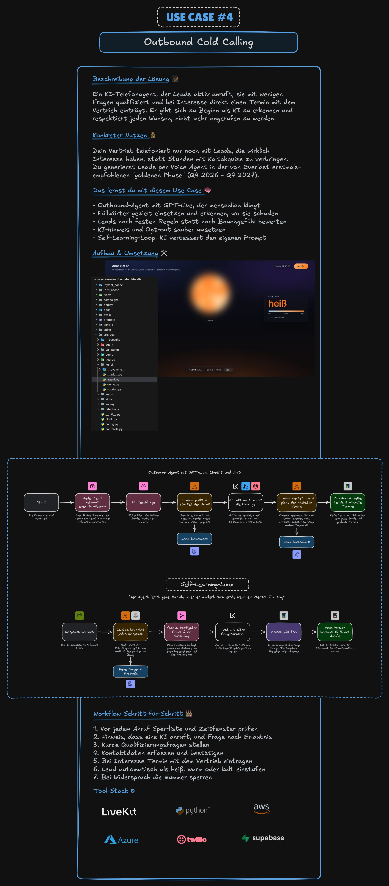

# Use Case 4: Outbound Cold Calling mit GPT-Live

Du baust mit Claude Code einen Agenten, der Firmen anruft und eine 60-Sekunden-Umfrage „KI im Mittelstand“ macht.
Das Gespräch führt GPT-Live über LiveKit, Termine, Wiederholungen und Auswertung laufen auf AWS in Frankfurt. Jede
Nacht schlägt der Agent eine Verbesserung an seinem Prompt vor, aber er ändert sich erst, wenn du sie freigibst.

**Botschaft:** GPT-Live klingt menschlich. KI-Hinweis, Lead-Score und Sperrliste kommen trotzdem aus dem Code.

**Im Video: Teil ⏱ folgt**

## So sieht das Ergebnis aus

Anna, die KI-Assistentin vom fiktiven „Veltrum Marktforschungsinstitut“, ruft an. Zuerst kommt ein fester
KI-Hinweis als Audiodatei, dann vier kurze Fragen, ein Terminvorschlag für einen Rückruf und am Ende eine
Ergebniskarte mit Einstufung heiß, warm oder kalt. Sagt jemand „Rufen Sie mich nie wieder an“, sperrt der Code die
Nummer, und der nächste Anruf wird verweigert, bevor das Modell überhaupt startet. Im Dashboard siehst du heiße
Leads, die nächsten Anruftermine und die Verbesserungsvorschläge der Lernschleife mit „Freigeben“ und „Ablehnen“.

Im Video siehst du die Browser-Demo: Das Telefon klingelt in einer Testseite, ganz ohne Telefonnetz. Die Anleitung
führt dich bis zum echten Telefon mit deutscher Nummer über Twilio (Prompt 11).

## Architektur

Zum Bearbeiten: [`assets/uebersicht.excalidraw`](assets/uebersicht.excalidraw) in [Excalidraw](https://excalidraw.com) öffnen.

## Stack

| Teil | Werkzeug | Aufgabe |
|---|---|---|
| Sprache | GPT-Live über Azure OpenAI (Sprachmodell, das gleichzeitig hört und spricht) | Spricht als Anna |
| Werkzeuge und Bewertung | `gpt-6-luna` über die Responses-API | Führt Tools aus und bewertet Gespräche |
| Echtzeit-Audio | LiveKit Agents 1.8.8 in Python, LiveKit Cloud EU | Verbindet Modell, Browser und Telefon, Rauschunterdrückung, Mailbox-Erkennung |
| Steuerung | AWS CDK, EventBridge Scheduler, SQS FIFO, Lambda, DynamoDB | Anruftermine, Warteschlange, Regeln, Leads und Sperrliste |
| Lernschleife | S3, Lambda Judge, Step Functions | Bewertung je Gespräch, nächtlicher Vorschlag mit Freigabe |
| Dashboard | S3, CloudFront, Cognito | Ergebnisse, heiße Leads, Freigabe |
| Telefon | Twilio Elastic SIP Trunk (Anschluss ans Telefonnetz) | Deutsche Nummer, echte Anrufe |
| Betrieb | Secrets Manager, CloudWatch, Budgets | Keys, Alarme, Kostengrenze |

## Konten, die du brauchst

| Dienst | Hinweis |
|---|---|
| AWS | Region Frankfurt (`eu-central-1`) |
| Azure mit Azure OpenAI | GPT-Live in Sweden Central, nur als Global Standard verfügbar. Alternativ OpenAI direkt |
| LiveKit Cloud | Projekt in der EU-Region anlegen, die Region lässt sich nachträglich nicht ändern |
| Twilio | Deutsche Nummer braucht ein genehmigtes Regulatory Bundle, das dauert mehrere Tage |

Kosten: In Prompt 10 legst du in AWS und Azure je ein Budget mit Warnung bei 20 Euro im Monat an und lässt dir die
Kosten für 500 Anrufe im Monat schätzen. Telefonnummer und Gesprächsminuten bei Twilio kommen dazu, Claude zeigt
dir den Preis vor dem Kauf.

## Los geht's

1. [`../00-vorbereitung/README.md`](../00-vorbereitung/README.md): Claude Code, Homebrew, Plan-Modus.
2. [`ANLEITUNG.md`](ANLEITUNG.md): Konten einrichten, dann Prompt für Prompt mit „Warum so“ und unseren Ergebnissen.
3. [`.env.example`](.env.example): Vorlage für deine `.env`.

Es gibt für diesen Use Case keinen Referenzcode. Du baust alles selbst mit Claude Code.
