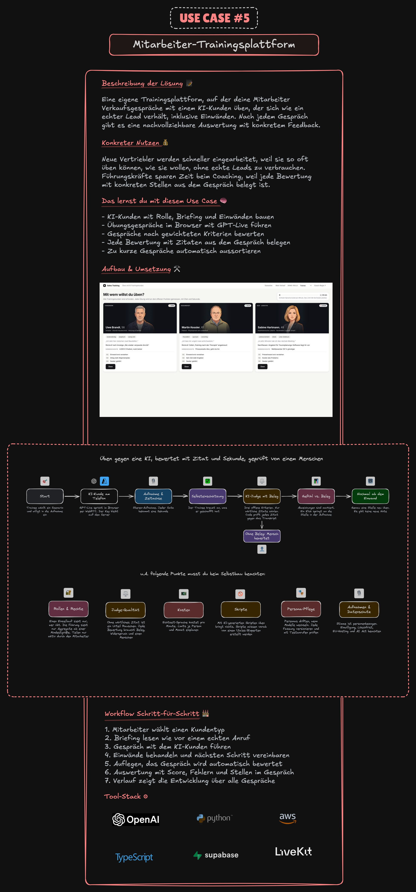

# 05 Eigene Trainingsplattform für Vertriebler

Du baust eine kleine Plattform, auf der deine Vertriebler gegen einen KI-Kunden telefonieren, so oft sie wollen, bevor
sie damit ans echte Telefon gehen. Der KI-Kunde spricht live im Browser, reagiert wie ein echter Lead und legt auf,
wenn das Gespräch schlecht läuft. Nach dem Auflegen bekommt der Mitarbeiter eine Auswertung, bei der jede Bewertung
auf eine Stelle im Gespräch zeigt.

**Botschaft:** Die KI spielt den Lead am Telefon. Die Auswertung zeigt mit Zitat und Zeitstempel, wo das Gespräch
gekippt ist.

Im Video siehst du unsere eigene Plattform. Hier bekommst du die Bauanleitung für eine lokale Version.

## Warum das ein guter Einstieg ist

Eine Trainingsplattform telefoniert nie mit echten Kunden. Du kannst sie intern testen, ohne eine einzige
Kundenbeziehung zu riskieren, und jeder im Team hört sofort, was die KI kann.

## So sieht das Ergebnis aus

1. **Szenario wählen.** Der Mitarbeiter sucht sich einen KI-Kunden aus, zum Beispiel einen skeptischen
   Handwerksmeister, und willigt in die Aufnahme ein.
2. **Anrufen.** Der KI-Kunde nimmt ab, bringt seinen Einwand und reagiert auf gute Fragen anders als auf
   Verkaufsgerede. Bei Fehlern wird er kürzer und legt irgendwann auf.
3. **Türsteher.** Ein Prüfschritt ohne KI entscheidet, ob das Gespräch überhaupt bewertet wird.
4. **Auswertung.** Ein Sprachmodell bewertet das Transkript nach festen Kriterien mit Gewicht. Jede Bewertung hat ein
   wörtliches Zitat, und der Code prüft, dass das Zitat wirklich im Transkript steht.
5. **Verlauf.** Jeder frühere Anruf steht mit Datum, Dauer und Score in einer Liste.
6. **Melden.** Wirkt eine Bewertung falsch, meldet der Mitarbeiter sie mit einem Klick.



Die bearbeitbare Fassung [`assets/uebersicht.excalidraw`](assets/uebersicht.excalidraw) öffnest du auf [excalidraw.com](https://excalidraw.com)
über „Öffnen“. Sie zeigt den Ablauf und die Punkte, die du beim Selbstbau beachten musst.

## Architektur

```
Browser (Mitarbeiter)                 kleiner lokaler Server                  Anbieter
─────────────────────                 ───────────────────────                 ────────
Mikrofon + Lautsprecher  ── WebRTC ─────────────────────────────────────────▶  GPT-Live (KI-Kunde)
        │                             hält den API-Key, tauscht nur den
        │                             Verbindungsaufbau (SDP) aus
        │
        └─ nach dem Auflegen ──▶  Transkript + Aufnahme speichern
                                  Türsteher (Code, ohne KI)
                                  Bewertung ──────────────────────────────▶  Sprachmodell als Judge
                                  Belegprüfung (Code)
                                  Verlauf je Mitarbeiter (Dateien)
```

- **Der Browser telefoniert direkt mit GPT-Live** (Sprachmodell von OpenAI, das gleichzeitig hört und spricht) über
  WebRTC (Technik für Audio in Echtzeit im Browser). So gibt es keinen Umweg und kaum Verzögerung.
- **Der Key bleibt auf dem Server.** Der Server tauscht nur den Verbindungsaufbau mit OpenAI aus. Die Seite im Browser
  kennt den Key nie.
- **Personas als Dateien.** Jeder KI-Kunde ist eine Markdown-Datei im Ordner `personas/`. Eine neue Fassung ist eine
  geänderte Datei, die du im Git vergleichen und zurückdrehen kannst.
- **Bewertung nach dem Auflegen.** Ein Sprachmodell als Judge (ein Modell, das prüft statt spricht) bewertet das
  Transkript. Der Code prüft jedes Zitat, bevor die Bewertung angezeigt wird.
- **Alles lokal.** Gespräche liegen als Dateien in einem Ordner je Gespräch, ohne Datenbank.

## Die Bewertung

| Kriterium | Gewicht | Was geprüft wird |
|---|---|---|
| Skripttreue | 30 % | Hält sich der Mitarbeiter an den Gesprächsleitfaden? |
| Gap | 25 % | Arbeitet er die Lücke heraus, zum Beispiel mit „Auf einer Skala von 1 bis 10, wo stehen Sie?“ und der Frage, was bis zur 10 fehlt? |
| Qualifizierung | 20 % | Klärt er Bedarf, Budget und wer entscheidet? |
| Verbindlichkeit | 10 % | Endet das Gespräch mit einem konkreten nächsten Schritt? |
| Fragetechnik | 10 % | Offene Fragen statt Monologe? |
| Tonalität | 5 % | Passt die Wortwahl zum Gegenüber? |

**Harte Fehler** lassen das Gespräch sofort durchfallen, egal wie gut der Rest war:

- „Preis genannt“: Ein Preis fällt, bevor das Problem des Kunden geklärt ist.
- „Termin ohne Entscheider“: Ein Termin wird vereinbart, obwohl der Mitentscheider nicht dabei ist.
- „Aufgelegt ohne nächsten Schritt“: Das Gespräch endet ohne vereinbarten nächsten Schritt.

**Türsteher:** Erst ab 60 Sekunden Gesprächsdauer und drei eigenen Beiträgen des Mitarbeiters gibt es eine Bewertung.
Bricht die Verbindung technisch ab, gibt es keine.

Gewichte und harte Fehler sind unser Beispiel für ein Erstgespräch mit einem Lead. Für deinen Vertrieb passt du sie an
deinen eigenen Gesprächsleitfaden an.

## Stack

| Baustein | Aufgabe | Ungefähre Kosten |
|---|---|---|
| GPT-Live (`gpt-live-1`) von OpenAI | spielt den KI-Kunden im Browser | 0,05 Dollar pro Minute, sekundengenau |
| Kleiner Node.js-Server, lokal | hält den Key, speichert Gespräche, Türsteher, Belegprüfung | kostenlos |
| Sprachmodell als Judge, frei wählbar | bewertet das Transkript | wenige Cent pro Gespräch |
| Chrome | WebRTC und Aufnahme im Browser | kostenlos |
| Kopfhörer | sonst landet die KI-Stimme im Mikrofon | |

Benötigte Konten: ein OpenAI-Konto mit Zugriff auf `gpt-live-1` und ein Konto für das Judge-Modell. Die Preise
haben den Stand Oktober 2026, mehr in [`ressourcen/kosten.md`](../ressourcen/kosten.md).

## Worauf du beim echten Einsatz achten solltest

Der Anruf ist der leichte Teil. Schwer wird alles drumherum, sobald echte Mitarbeiter üben:

- **Üben, nicht überwachen.** Die Auswertung gehört dem Mitarbeiter. Kein Noten-Ranking, keine Abmahnung, kein Bonus
  aus Übungsläufen.
- **Rollen und Rechte.** Einen einzelnen Lauf sieht nur, wer übt. Die Führung sieht höchstens Durchschnittswerte ab
  einer Mindestzahl verschiedener Personen. Teilen nur aktiv durch den Mitarbeiter.
- **Kosten begrenzen.** Echtzeit-Sprache kostet pro Minute. Plane ein Minutenkontingent je Person und Monat ein.
- **Personas pflegen.** Personas verhalten sich anders, wenn das Modell wechselt. Versioniere jede Fassung und prüf sie
  mit Testanrufen.

## Video-Kapitel

⏱ Zeitmarke folgt, sobald das Video online ist.

## Los geht's

1. Richte Claude Code ein: [`00-vorbereitung/`](../00-vorbereitung/)
2. Öffne die Bauanleitung: [`BEISPIEL-PROMPTS.md`](BEISPIEL-PROMPTS.md)
3. Drei fiktive KI-Kunden als Vorlage liegen in [`personas/`](personas/).
