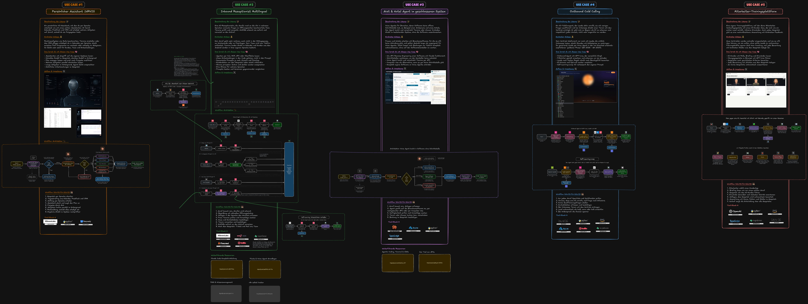

# Voice Agents MEGA-Kurs 2027

Das Begleit-Repo zum kostenlosen [Voice Agents MEGA-Kurs](https://www.youtube.com/@everlastai) von Everlast AI.
Hier findest du alles, um die Use Cases aus dem Video selbst nachzubauen: die Prompts, die wir an Claude Code
geschickt haben, die Begründung zu jeder Entscheidung, unsere Messergebnisse und die nötigen Ressourcen.

> Video: ⏱ Link folgt

## Alle Use Cases auf einen Blick

Die bearbeitbare Fassung liegt in [`ressourcen/kursuebersicht.excalidraw`](ressourcen/kursuebersicht.excalidraw). Öffne sie auf [excalidraw.com](https://excalidraw.com) über Menü und „Öffnen“.

## So arbeitest du mit dem Repo

1. Richte einmal Claude Code ein: [`00-vorbereitung/`](00-vorbereitung/)
2. Such dir einen Use Case aus und öffne dessen `ANLEITUNG.md`.
3. Schick die Prompts der Reihe nach an Claude Code. Geh erst weiter, wenn das Ergebnis passt.

Alle Prompts eines Use Cases stehen auf einer Seite, jeder in einem eigenen Textblock, den du direkt kopieren kannst.

## Die Use Cases

| # | Use Case | Was du bekommst | Stack |
|---|---|---|---|
| 1 | [JARVIS: Sprachassistent, der wirklich arbeitet](01-jarvis/) | **Open-Source-Code** zum Weiterbauen, plus Erweiterungs-Prompts | ElevenLabs, Claude, Next.js, Python |
| 2 | [Inbound KI-Rezeptionist für einen Onlineshop](02-inbound-rezeptionist/) | Schritt-für-Schritt-Anleitung mit Prompts | ElevenLabs, n8n, Supabase, Twilio |
| 3 | [Arzt und Hotel: Software ohne Schnittstelle](03-arzt-hotel/) | Anleitung mit Prompts, plus Demo-Hotelsoftware | OpenAI GPT-Live, Computer Use, Playwright |
| 4 | [Outbound Cold Calling mit GPT-Live](04-outbound-cold-calling/) | Anleitung mit Prompts | GPT-Live, LiveKit, AWS, Twilio |
| 5 | [Eigene Trainingsplattform für Vertriebler](05-trainingsplattform/) | Bauanleitung mit Beispiel-Prompts | GPT-Live, lokaler Server |

## Ressourcen

| Datei | Inhalt |
|---|---|
| [`ressourcen/best-practices.md`](ressourcen/best-practices.md) | Was wir beim Bauen und Testen gelernt haben, mit Messwerten |
| [`ressourcen/evaluation.md`](ressourcen/evaluation.md) | Wie du misst, ob eine neue Version deines Agenten wirklich besser ist |
| [`ressourcen/kosten.md`](ressourcen/kosten.md) | Was ein Voice Agent pro Minute kostet, mit Rechenbeispiel |
| [`ressourcen/glossar.md`](ressourcen/glossar.md) | Die wichtigsten Begriffe einfach erklärt |
| [`ressourcen/quellen.md`](ressourcen/quellen.md) | Alle Quellen aus dem Video |

## Wichtig, bevor du loslegst

- **Nur Testdaten.** Alle Namen, Nummern und Firmen in den Anleitungen sind erfunden. Ruf nur eigene Testnummern an.
- **Keys gehören in die `.env`.** Nie in den Chat, nie ins Git. Jeder Use Case hat eine `.env.example`.
- **Modelle ändern sich schnell.** Die Anleitungen haben den Stand Oktober 2026. Lass Claude Code vor dem Bauen
  in der aktuellen Doku prüfen, ob Modellnamen und Befehle noch stimmen.

## Haftungshinweis

Alle Anleitungen, Prompts und Referenzbauten in diesem Repo sind technische Demonstrationen für Lern- und
Anschauungszwecke. Sie zeigen, was mit Voice Agents technisch möglich ist, und sind keine Empfehlung, sie in dieser Form
im echten Betrieb einzusetzen. Wo ein Baustein fremde Software ohne offene Schnittstelle anbindet, wie die
Praxissoftware in Use Case 3, ist er ausdrücklich eine theoretische technische Option.

- **Du handelst eigenverantwortlich.** Ob ein Baustein für deinen Betrieb zulässig ist, etwa mit Blick auf die
  Nutzungsbedingungen fremder Software, Datenschutz und Telefonwerbung, prüfst du selbst, im Zweifel mit einer
  Anwältin oder einem Anwalt.
- **Keine Rechtsberatung.** Die rechtlichen Einordnungen in den Anleitungen geben unseren Kenntnisstand wieder und
  ersetzen keine Beratung im Einzelfall.
- **Keine Haftung.** Für Schäden aus der Nutzung der Inhalte haften wir nicht, soweit das gesetzlich zulässig ist.
  Zusätzlich gilt die [Lizenz](LICENSE).
- **Marken.** Plattformen und Dienste werden nur zur Beschreibung genannt. Es besteht keine Verbindung zu ihren
  Anbietern.
- **Partnerlinks.** Einige Links zu Diensten wie ElevenLabs und n8n sind Partnerlinks. Schließt du darüber ein Konto
  ab, erhalten wir eine Provision. Für dich ändert sich am Preis nichts.

## Du willst das nicht selbst bauen?

Wir setzen Voice Agents für Unternehmen um: [kiberatung.de](https://kiberatung.de/?utm_source=github&utm_medium=repo&utm_campaign=mega-kurs-voice-agents-2027&utm_content=root-readme)

## Lizenz

- Code in [`01-jarvis/`](01-jarvis/) und [`03-arzt-hotel/hotel-demo/`](03-arzt-hotel/hotel-demo/): [MIT](01-jarvis/LICENSE)
- Alle übrigen Inhalte: Du darfst sie zum Lernen nutzen und für deinen eigenen Betrieb nachbauen und anpassen. Die
  Inhalte selbst weiterzugeben oder zu verkaufen ist nicht erlaubt. Details in der [LICENSE](LICENSE).

© 2026 Everlast Consulting GmbH
